# PatientCase_AI: Product Requirements Document

**AI-Powered Patient Case-Taking Software**
Clinical history capture and multi-document digitization for Indian hospital OPDs

| | |
|---|---|
| **Document** | Product Requirements Document (PRD) |
| **Product** | PatientCase_AI (the problem statement's working name was "MediKiosk") |
| **Problem statement** | SIH 26047, Patient Case-Taking Software |
| **Version / status** | v0.2, Draft for review |
| **Date** | October 31, 2026 |
| **Languages** | English, Hindi, Marathi |
| **Database** | PostgreSQL |

> **How to read this document.** Requirements marked **M (Must)** are stated or directly implied by the SIH 26047 problem statement or by a decision recorded in Section 2. Requirements marked **S (Should)** and all numeric targets are proposals, labelled as such, to be confirmed by the team. Diagrams are written in [Mermaid](https://mermaid.js.org) and render in GitHub, GitLab, VS Code (with a Mermaid extension) and most Markdown viewers.
>
> **Note on the source.** Section 3.2 of the problem statement contains only the placeholder "Insert Table". Its content is not available and is not guessed here (see Open Questions, Section 17).

---

## Contents

1. [Executive summary](#1-executive-summary)
2. [Decisions and change log](#2-decisions-and-change-log)
3. [Background and problem](#3-background-and-problem)
4. [Goals, non-goals and success metrics](#4-goals-non-goals-and-success-metrics)
5. [Users, roles and separate portals](#5-users-roles-and-separate-portals)
6. [Product overview and journeys](#6-product-overview-and-journeys)
7. [Functional requirements](#7-functional-requirements)
8. [Voice interaction and icon system](#8-voice-interaction-and-icon-system)
9. [Doctor dashboard](#9-doctor-dashboard)
10. [Non-functional requirements](#10-non-functional-requirements)
11. [System architecture](#11-system-architecture)
12. [Data design (PostgreSQL)](#12-data-design-postgresql)
13. [Integrations and external dependencies](#13-integrations-and-external-dependencies)
14. [Compliance, privacy and consent](#14-compliance-privacy-and-consent)
15. [User experience principles](#15-user-experience-principles)
16. [Assumptions, constraints and risks](#16-assumptions-constraints-and-risks)
17. [Open questions](#17-open-questions)
18. [Proposed delivery phasing](#18-proposed-delivery-phasing)
19. [Acceptance criteria](#19-acceptance-criteria)
20. [Traceability](#20-traceability)
21. [Glossary](#21-glossary)
22. [Detailed development plan](#22-detailed-development-plan)

---

## 1. Executive summary

Indian public-hospital outpatient departments (OPDs) see thousands of patients a day, and consultation time is often only 2 to 5 minutes. In that window the physician must take a history, examine, read old records, decide, counsel and prescribe. History taking, which classical teaching credits with reaching the correct diagnosis in roughly 70 to 80 percent of cases, is the first thing to be squeezed. Patients also arrive with paper prescriptions, lab reports and discharge summaries that are handwritten, multilingual and out of order.

**PatientCase_AI** is a software platform with three separate role-based portals (Patient, Staff, Doctor). A patient, including a new patient who registers themselves, records a comprehensive medical history by natural voice conversation and guided touchscreen interaction in **English, Hindi or Marathi**, uploads **multiple** prior medical documents at once, and receives a structured, physician-ready clinical history summary built from the interview and from a **combined analysis of all uploaded files**. The summary appears on a user-friendly **doctor dashboard**, is pushed to the hospital information system (HIS), and is linked to the patient's ABHA record under the Ayushman Bharat Digital Mission (ABDM). All structured data is stored in **PostgreSQL**. Everything happens **before** the consultation, with minimal staff assistance.

### Product vision

> *Every patient arrives in the consultation room with a complete, structured, verified history, so the physician's few minutes go to examination, reasoning and counselling.*

### The four capabilities (from the problem statement) plus registration

| Module | Name | Purpose |
|---|---|---|
| A | Conversational Multimodal History Engine | Adaptive voice and touch interview, listening-mode icons, AYUSH mode, red-flag detection |
| B | Medical Document Digitization and Intelligence | Multi-file upload, OCR, extraction, and cross-document analysis |
| C | Structured History Summary Generator | One physician-ready summary in standard format, editable |
| D | Consent, Privacy and ABDM Integration | ABHA authentication, consent, secure processing, FHIR push |
| R | Registration and Identity | Self-registration of new patients, returning patient lookup |

The AI never makes an autonomous diagnosis. The summary is a draft the physician accepts, amends or rejects.

---

## 2. Decisions and change log

This version incorporates the following decisions.

| # | Decision | Where it appears |
|---|---|---|
| CR1 | Deliver this PRD as a Markdown file | This file |
| CR2 | Product name is **PatientCase_AI** | Throughout |
| CR3 | Speech recognition, speech output, UI and summaries support **English, Hindi and Marathi** | FR-A3, A7, A8, B3, C5; Section 8; NFRs |
| CR4 | Patients can **upload multiple files** in one session and the system **analyses them together** | FR-B1 to B13; Section 6.4 |
| CR5 | **Voice-based conversation** with a clear **icon set** to choose whether the patient hears the adaptive questionnaire | FR-A9 to A11; Section 8 |
| CR6 | **Separate pages (portals)** for Patients, Staff and Doctors | Section 5; FR-P1 to P5 |
| CR7 | **New patients can register themselves** | FR-R1 to R7; Section 6.3 |
| CR8 | A **user-friendly doctor dashboard** | Section 9; FR-T and DB requirements |
| CR9 | **Diagrams and flowcharts** added | Sections 5, 6, 8, 9, 11, 12 |
| CR10 | **PostgreSQL** is the database | Section 12; NFRs |

One consequence to note: the problem statement specifies a physician-facing summary in English or Hindi. Because Marathi is now a supported language, this PRD makes the physician summary selectable in **English, Hindi or Marathi**.

---

## 3. Background and problem

### 3.1 The clinical history-taking bottleneck

- India runs one of the most patient-dense health systems in the world. Tertiary government hospitals and apex institutions routinely register **4,000 to 10,000 OPD patients per day**.
- Doctor-patient consultation time is frequently reported at **2 to 5 minutes**; a 2017 BMJ Open study across 67 countries put India's average primary-care consultation at just over 2 minutes.
- The result is systematic under-elicitation of history, missed comorbidities, repeated questioning across visits, and diagnostic error.
- AYUSH institutions face extra burden. Ayurvedic history (Trividha, Ashtavidha and Dashavidha Pariksha) requires assessment of Prakriti, Vikriti, Agni, Koshtha, Ahara-Vihara, Nidana and Samprapti, far more than allopathic intake. It cannot be captured manually within OPD time, so practitioners abbreviate the very assessment that defines personalized Ayurvedic care.

### 3.2 Documentation and records fragmentation

- Patients carry paper prescriptions, lab reports, discharge summaries and imaging films from multiple providers, often handwritten, in varying languages and in no chronological order.
- Physicians scan these manually during the consultation, consuming scarce time. No point-of-entry mechanism digitizes, structures and orders them before the patient reaches the consulting room.
- ABDM has created national digital health infrastructure (ABHA IDs, the Health Information Exchange, FHIR-based interoperability). The **first-mile problem** is unsolved: no efficient, patient-facing platform captures structured history and digitizes documents into the ABDM ecosystem before the encounter.

### 3.3 The opportunity

Self-service kiosks transformed banking (ATMs), aviation (self check-in) and quick-service restaurants by moving structured data entry to the user. Hospital check-in kiosks exist in developed countries but only handle administrative check-in; none perform deep, AI-driven, multimodal clinical history acquisition with document digitization. Mature enabling technologies now make it feasible: speech recognition for Indian languages (Bhashini / AI4Bharat models), large language models for conversational history elicitation, OCR for handwritten and printed documents, and ABDM's FHIR interoperability.

### 3.4 Problem definition (section 2.1 of the statement)

> "There is no purpose-built, patient-facing software platform that enables patients to independently and comprehensively record their medical history, through both natural spoken conversation and guided touchscreen interaction, and simultaneously digitize their existing physical medical documents, generating a structured, physician-ready clinical history summary that integrates with the hospital information system and the ABDM ecosystem before the patient enters the consultation room."

### 3.5 Why existing solutions fall short

| Existing approach | Limitation stated in the problem statement |
|---|---|
| Hospital registration systems | Capture only demographics and appointment data. No clinical history, no document processing. |
| Mobile health apps and tele-triage chatbots | Need smartphone literacy, connectivity and prior enrolment, which excludes elderly, rural, low-literacy and first-visit patients. |
| Manual nurse-led history desks | Limited by human resources, do not scale to 5,000+ daily patients, and reintroduce the same bottleneck. |
| Generic document scanners | Digitize images but do not extract, structure or chronologically organize clinical content, or link it to a history or ABHA record. |

### 3.6 Challenges the solution must overcome (section 2.3)

| # | Challenge | What it means for the product |
|---|---|---|
| C1 | Multilingual, multi-accent voice capture in noisy hospital environments | English, Hindi and Marathi speech, varied accents, noisy wards |
| C2 | Accessibility for low-literacy and elderly users | Icon-driven UI, audio prompts, conversational guidance, zero training |
| C3 | Accurate clinical history structuring | Free-form narration becomes a standard history, plus Dashavidha Pariksha for AYUSH |
| C4 | Reliable document digitization | OCR of handwritten and printed documents with entity extraction, now across multiple files |
| C5 | Privacy, consent and data security | DPDP Act 2023 and ABDM consent framework compliance |

---

## 4. Goals, non-goals and success metrics

### 4.1 Product goals

- **G1.** Let any patient, including new, first-time, elderly, rural and low-literacy patients, register and record a comprehensive history independently, in English, Hindi or Marathi, by voice or touch.
- **G2.** Digitize, structure and chronologically organize **all** of the patient's existing paper records from a single multi-file upload.
- **G3.** Deliver a concise, structured, physician-ready summary on the doctor dashboard the moment the patient is called.
- **G4.** Integrate with the HIS and link to the patient's ABHA record through ABDM-compliant FHIR interfaces.
- **G5.** Surface emergency symptoms immediately to triage staff instead of routine queueing.
- **G6.** Protect patient data with consent-first design and compliance with the DPDP Act 2023 and the ABDM consent framework.
- **G7.** Give patients, staff and doctors each a focused interface that shows only what their role needs.

### 4.2 Non-goals

- Making an autonomous diagnosis. All analysis supports the physician, who decides.
- Replacing the physician's examination, reasoning, counselling or prescribing.
- Administrative check-in only.
- Requiring patients to own a smartphone, have home connectivity, or enrol in advance.

### 4.3 Success metrics

The problem statement defines no metrics. The following are **proposals to be baselined in a pilot**.

| Metric | Definition | Proposed target |
|---|---|---|
| Independent completion rate | Patients who finish intake without staff intervention | Clear majority; set after pilot |
| Self-registration completion rate | New patients who complete registration unaided | Set after pilot |
| Median intake time | Language selection to submission | Set with clinicians |
| Listening-mode usage | Share of sessions using voice prompts vs read-only | Tracked, no target |
| ASR word error rate | Per language (English, Hindi, Marathi) in a noisy ward | Set per language after benchmarking |
| OCR field accuracy | Medications, doses, lab values, dates; printed vs handwritten | Set per document type after benchmarking |
| Multi-file analysis time | Upload complete to consolidated analysis ready | Set after benchmarking |
| History completeness | Required sections populated per session | Set per specialty |
| Physician edit rate | Summary fields amended or rejected | Track and reduce |
| Red-flag alert latency | Symptom entry to alert on staff and doctor screens | Near-immediate |
| Consent integrity | Sessions with valid consent recorded before capture | 100% |

---

## 5. Users, roles and separate portals

### 5.1 User roles

| Role | Description | Needs from the product |
|---|---|---|
| **Patient** | Any OPD patient, including new, elderly, rural, low-literacy and first-time users | A zero-training, icon-driven, audio-guided way to register, describe their problem in their language, upload their papers, and control what is shared |
| **Staff** | Registration desk, nurse or triage staff | See priority alerts, assist patients, register patients on their behalf, manage the queue |
| **Doctor** (allopathic or AYUSH) | Physician with 2 to 5 minutes per patient | A complete, structured, verified history in seconds with source documents and flags; full control to edit |
| **Hospital admin** (Should) | Manages users, departments and configuration | Create staff and doctor accounts, set departments, view audit logs |
| **Caregiver** (assumption) | Accompanies a patient who cannot self-report | Complete intake on the patient's behalf (see Open Questions) |

### 5.2 Separate portals

The product has **three separate web portals**, each with its own address, login behavior, navigation and visual design. A user can only reach the portal that matches their role.

| Portal | Address (proposed) | Primary users | Authentication |
|---|---|---|---|
| Patient portal | `/patient` | Patients at hospital terminals | ABHA ID, Aadhaar details, mobile OTP, or new registration; no password to remember |
| Staff portal | `/staff` | Registration and triage staff | Staff credentials with multi-factor option |
| Doctor portal | `/doctor` | Physicians | Doctor credentials with multi-factor option |

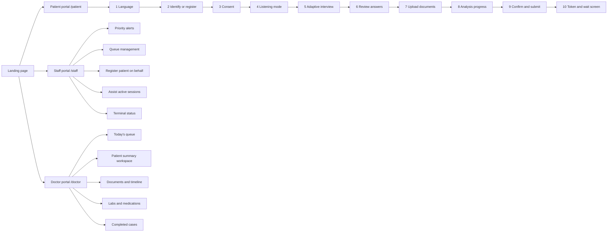

### 5.3 Screen inventory

| Portal | Screen | Purpose |
|---|---|---|
| Patient | Language | Choose English, Hindi or Marathi (changeable at any time) |
| Patient | Identify or register | Enter or scan ABHA ID or Aadhaar, use mobile OTP, or register as a new patient |
| Patient | Consent | Audio-explained, granular, revocable consent |
| Patient | Listening mode | Choose how to hear and answer questions (Section 8) |
| Patient | Adaptive interview | One question per screen with voice and touch controls |
| Patient | Review answers | Read back and correct captured answers |
| Patient | Upload documents | Add multiple files by camera, scanner or file picker |
| Patient | Analysis progress | Per-file status while documents are read |
| Patient | Confirm and submit | Final confirmation with audio read-back |
| Patient | Token and wait | Queue token, calm waiting message, no clinical results shown |
| Staff | Priority alerts | Emergency flags with the triggering answer; acknowledge button |
| Staff | Queue | Ordered patient list with status and priority |
| Staff | Register on behalf | Same registration form with staff assistance |
| Staff | Assist session | Observe or help a stuck patient session |
| Staff | Terminal status | Which terminals are free, in use or needing help |
| Doctor | Today's queue | Waiting patients with alerts, complaint and readiness |
| Doctor | Summary workspace | Structured summary with edit, accept, reject |
| Doctor | Documents and timeline | All uploaded files, extracted data and chronological timeline |
| Doctor | Labs and medications | Consolidated lab table with flags and medication list with interaction flags |
| Doctor | Completed cases | Finished consultations and exports |

**Rule:** patients never see AI analysis, abnormal-value flags or alert levels. They see only their own answers read back and a calm status message.

---

## 6. Product overview and journeys

### 6.1 Product summary

PatientCase_AI is used by the patient before consultation, typically at a hospital terminal with a touchscreen, microphone, speaker and document scanner or camera. The patient interacts by voice and touch; the platform converses, captures, digitizes, analyses, summarizes and routes. The physician and staff receive the output on their own portals.

### 6.2 End-to-end patient journey (section 3.4 of the statement)

| Step | What happens | Modules |
|---|---|---|
| 1. Identify | Patient logs in with ABHA ID or Aadhaar details, or registers as new; selects a language; gives audio-guided consent | R, D, A |
| 2. Converse | AI conducts an adaptive voice and touch interview; red flags trigger priority triage | A |
| 3. Scan | Patient uploads **multiple** prior documents; AI digitizes, structures and analyses them together | B |
| 4. Summarize and route | AI generates the structured summary, links it to ABHA, pushes it to the HIS; the summary appears on the doctor dashboard | C, D |
| 5. Consult | Physician reviews the complete history in seconds, edits or confirms, and uses the visit for examination, reasoning and counselling | C |

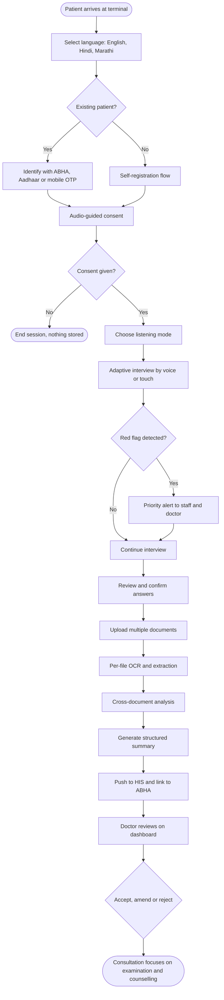

### 6.3 New patient self-registration

New patients register themselves at the terminal, by voice or touch, without staff help. Staff can also register a patient on their behalf from the staff portal.

**Registration fields (proposed):** full name, age or date of birth, sex, mobile number, preferred language, address or locality (optional), emergency contact (optional), and optional ABHA creation or linking. Only what is needed for the visit is collected.

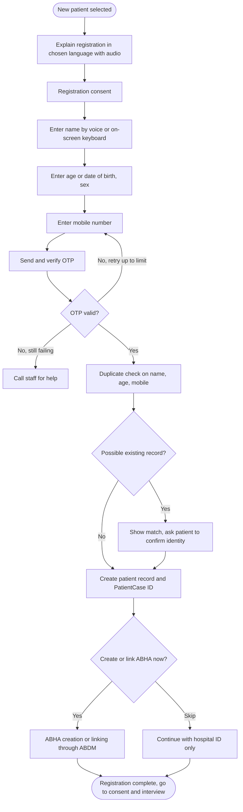

### 6.4 Multi-file upload and combined analysis

The patient can add **several files in one session** (for example three prescriptions, two lab reports and a discharge summary). The system reads each file and then analyses them **together**.

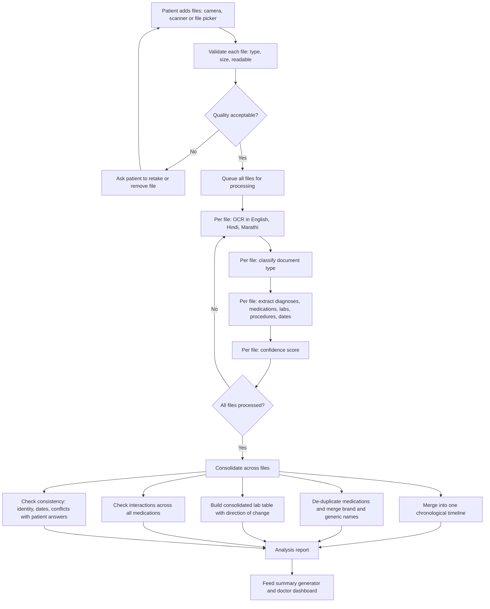

**Cross-document analysis includes (all decision support for the physician, none autonomous):**

- **Consolidated timeline:** every document dated and ordered, with the source file shown.
- **Medication reconciliation:** one merged list showing each drug, dose and frequency per document, with duplicates merged, changes in dose highlighted, and drugs from the patient's own answers included.
- **Consolidated lab table:** each test across all reports and dates with value, unit, reference range, out-of-range flag, and the **direction of change** (up, down, unchanged). Clinical interpretation of the trend stays with the doctor.
- **Interaction flags:** potential drug interactions across the full combined medication list.
- **Consistency checks:** name, age or sex mismatches between files (possible wrong-patient document), conflicts between documents, and conflicts between documents and what the patient said (for example the patient reports no medicines but a prescription lists some).

---

## 7. Functional requirements

Priority key: **M** = Must; **S** = Should (proposed). The Source column cites the problem statement section or this PRD's change request.

### 7.1 Module R: Registration and Identity

| ID | Requirement | Priority | Source |
|---|---|---|---|
| FR-R1 | Allow a **new patient to register themselves** at the terminal without staff help. | M | CR7, 3.4 step 1 |
| FR-R2 | Support registration by voice or touch in English, Hindi and Marathi. | M | CR7, CR3 |
| FR-R3 | Collect only the minimum fields needed (name, age or date of birth, sex, mobile, language; optional address, emergency contact). | M | CR7, 2.3 |
| FR-R4 | Verify the mobile number by one-time password. | S | CR7 |
| FR-R5 | Detect likely duplicate patients (name, age, mobile) and ask the patient or staff to confirm before creating a new record. | S | CR7 |
| FR-R6 | Create a unique PatientCase ID for every registered patient and let the patient continue with or without ABHA. | M | CR7 |
| FR-R7 | Offer optional ABHA creation or linking during registration through ABDM. | S | 3.3 Module D |
| FR-R8 | Let staff register a patient on their behalf from the staff portal. | S | CR6, CR7 |
| FR-R9 | Look up returning patients by ABHA ID, Aadhaar details, mobile OTP or PatientCase ID. | M | 3.4 step 1 |

### 7.2 Module A: Conversational Multimodal History Engine

Built on speech recognition for English, Hindi and Marathi, a dialogue manager constrained by a clinical history ontology, and text-to-speech for audio prompts.

| ID | Requirement | Priority | Source |
|---|---|---|---|
| FR-A1 | Conduct a structured clinical history interview through both natural voice conversation and guided touchscreen interaction. | M | 2.1, 3.1, 3.3 |
| FR-A2 | Make every question answerable by speaking **or** tapping. | M | 3.3 |
| FR-A3 | Support **English, Hindi and Marathi**; the patient selects a language at the start and can switch at any time without losing answers. | M | CR3, 3.3 |
| FR-A4 | Capture presenting complaints, history of present illness, past medical and surgical history, drug and allergy history, family and personal history, and review of systems. | M | 1.1, 2.3 |
| FR-A5 | Adaptive questioning: branch dynamically on the chief complaint and prior answers to elicit a complete HPI and review of systems (for example SOCRATES for chest pain: onset, character, radiation, aggravating and relieving factors). | M | 3.3 |
| FR-A6 | Constrain the dialogue manager with a clinical history ontology. | M | 3.3 |
| FR-A7 | Recognize speech in English, Hindi and Marathi across accents and in noisy hospital environments. | M | CR3, 2.3 |
| FR-A8 | Speak every question and instruction aloud in the patient's language using text-to-speech, **when the patient chooses listening mode**. | M | CR3, CR5 |
| FR-A9 | At the start of the interview, let the patient choose a **listening mode** using large icons: *Listen and Speak*, *Listen and Tap*, or *Read and Tap* (Section 8). | M | CR5 |
| FR-A10 | Provide persistent per-question voice controls as icons: listen (speaker on or off), repeat, slower speed, speak answer, tap answer, skip, back and help. | M | CR5 |
| FR-A11 | Apply the chosen listening mode to **adaptive follow-up questions** too, and let the patient change it at any time from a header icon. | M | CR5 |
| FR-A12 | Provide an icon-driven interface with conversational guidance that a first-time, non-tech-savvy patient can use with zero training. | M | 2.3 |
| FR-A13 | Convert free-form narration into the standardized, physician-readable history structure. | M | 2.3 |
| FR-A14 | AYUSH history mode: extended interview capturing Dashavidha Pariksha (Prakriti, Vikriti, Sara, Samhanana, Pramana, Satmya, Sattva, Ahara Shakti, Vyayama Shakti, Vaya) and Ahara-Vihara. | M | 3.3 |
| FR-A15 | In AYUSH mode, also cover Agni, Koshtha, Nidana and Samprapti. | S | 1.1 |
| FR-A16 | Red-flag detection: flag emergency symptoms (for example acute chest pain with dyspnoea, stroke symptoms) and trigger an immediate priority alert to staff and doctor instead of routine queueing. | M | 3.3 |
| FR-A17 | Let the patient review and correct captured answers using audio read-back and on-screen confirmation. | S | 3.3 Module C |
| FR-A18 | Provide a call-for-help button on every screen that alerts staff. | S | 3.1 |

### 7.3 Module B: Medical Document Digitization and Intelligence (multi-file)

| ID | Requirement | Priority | Source |
|---|---|---|---|
| FR-B1 | Allow the patient to add **multiple files in a single session** (prescriptions, lab reports, discharge summaries) using camera, scanner or file picker. | M | CR4, 3.3 |
| FR-B2 | Accept common image and PDF formats. Proposed limits: up to 15 files per session, up to 10 MB per file, up to 10 pages per PDF; limits are configurable. | S | CR4 |
| FR-B3 | Run OCR on printed and handwritten documents in English, Hindi and Marathi. | M | CR3, 2.3 |
| FR-B4 | Classify each file (prescription, lab report, discharge summary, other). | S | 3.3 |
| FR-B5 | Extract diagnoses, medications with dosages, investigation results with values and reference ranges, and procedure or surgery history from each file. | M | 3.3 |
| FR-B6 | Show **per-file status** (waiting, reading, done, needs attention) with progress, and let the patient remove, retake or reorder files before submission. | M | CR4 |
| FR-B7 | Process files in parallel where possible and show partial results as each file finishes. | S | CR4 |
| FR-B8 | **Cross-document analysis:** merge all files into one chronological timeline. | M | CR4, 3.3 |
| FR-B9 | **Medication reconciliation** across all files and the patient's answers: merge duplicates and brand or generic names, and highlight dose changes. | M | CR4 |
| FR-B10 | **Consolidated lab table** across files and dates with out-of-range highlighting and direction of change; clinical interpretation is left to the physician. | M | CR4, 3.3 |
| FR-B11 | Flag potential drug interactions across the combined medication list. | M | 3.3 |
| FR-B12 | Run consistency checks across files and against the patient's answers (identity mismatch, conflicting data, missing dates). | M | CR4 |
| FR-B13 | Show an extraction confidence indicator and a manual review path for low-confidence content; never present uncertain values as certain. | S | 2.3 |
| FR-B14 | Keep the original scan next to each extracted field so the physician can verify. | S | 3.3 |
| FR-B15 | Link digitized documents to the structured history and to the patient's ABHA record. | M | 2.2, 3.4 |

### 7.4 Module C: Structured History Summary Generator

| ID | Requirement | Priority | Source |
|---|---|---|---|
| FR-C1 | Synthesize the conversational history and the **combined analysis of all uploaded files** into one concise, physician-ready summary. | M | 3.3, CR4 |
| FR-C2 | Use the standard format: Chief complaint, HPI, Past medical and surgical, Drug and allergy, Family, Personal, Review of systems, Prior investigations summary. | M | 3.3 |
| FR-C3 | Present the summary on the doctor dashboard the moment the patient is called into consultation. | M | 3.3, CR8 |
| FR-C4 | Keep the physician in full control: the summary is a draft to accept, amend or reject, never an autonomous diagnosis. | M | 3.3 |
| FR-C5 | Patient-facing audio confirmation in the patient's language (English, Hindi or Marathi); physician-facing summary selectable in English, Hindi or Marathi. | M | CR3, 3.3 |
| FR-C6 | Show the source of each item (patient narration or a named file) so the physician can judge reliability. | S | 3.3 |
| FR-C7 | Save the confirmed summary and record who edited what and when. | S | 3.4 step 5 |

### 7.5 Module D: Consent, Privacy and ABDM Integration

| ID | Requirement | Priority | Source |
|---|---|---|---|
| FR-D1 | Authenticate the patient via ABHA ID (entered or scanned), Aadhaar details, mobile OTP, or registration as a new patient. | M | 3.3, 3.4 |
| FR-D2 | Obtain explicit consent for data capture and sharing before collecting any data. | M | 3.3 |
| FR-D3 | Make consent granular and revocable, with an audio explanation in English, Hindi or Marathi. | M | 3.3, CR3 |
| FR-D4 | Push the structured history to the hospital HIS or EMR. | M | 3.3 |
| FR-D5 | Link the structured history to the patient's ABHA Personal Health Record through FHIR APIs. | M | 3.3 |
| FR-D6 | Process voice and document AI securely within the software platform. | M | 3.3 |
| FR-D7 | Clear temporary session data (raw audio, temporary images, working files) immediately after submission. | M | 3.3 |
| FR-D8 | Comply with the Digital Personal Data Protection Act 2023. | M | 2.3 |
| FR-D9 | Comply with the ABDM consent framework. | M | 2.3 |
| FR-D10 | Keep an auditable log of consent events and of who accessed or changed patient data. | S | 2.3 |

### 7.6 Portals, triage and role access

| ID | Requirement | Priority | Source |
|---|---|---|---|
| FR-P1 | Provide a **separate Patient portal** with patient-only screens. | M | CR6 |
| FR-P2 | Provide a **separate Staff portal** with priority alerts, queue, registration on behalf and session assistance. | M | CR6 |
| FR-P3 | Provide a **separate Doctor portal** with the dashboard and patient workspace. | M | CR6, CR8 |
| FR-P4 | Enforce role-based access: a user can only reach their own portal and the data their role allows; every access is logged. | M | CR6, 2.3 |
| FR-P5 | Never show analysis results, abnormal-value flags or alert levels in the Patient portal. | M | CR6, 3.3 |
| FR-P6 | Provide a minimal admin console to create staff and doctor accounts and departments. | S | CR6 |
| FR-T1 | Show priority alerts on the staff dashboard ahead of routine cases, with the triggering answer visible and an acknowledge action. | M | 3.3 |
| FR-T2 | Show the same alert as a banner on the doctor dashboard for that doctor's patients. | M | 3.3 |

---

## 8. Voice interaction and icon system

### 8.1 Voice-based conversation

The patient converses with the system by voice: the system **speaks** each question (text-to-speech) and **listens** for the answer (speech recognition), or the patient taps. Every adaptive follow-up question follows the same rules. The patient chooses at the start whether they want to **hear** the questions.

### 8.2 Listening-mode selector

Shown once before the interview and always changeable from the header. Each choice is a large card with an icon, a short label in the patient's language, and an audio cue on selection.

```
+--------------------------------------------------------------+
|   How would you like to answer?        [🌐 English|हिंदी|मराठी] |
|                                                              |
|  +----------------+  +----------------+  +----------------+  |
|  |   🔊  +  🎤    |  |   🔊  +  👆    |  |   📖  +  👆    |  |
|  |                |  |                |  |                |  |
|  | Listen & Speak |  |  Listen & Tap  |  |   Read & Tap   |  |
|  |  सुनें और बोलें |  |  सुनें और छुएँ  |  | पढ़ें और छुएँ   |  |
|  |  ऐका आणि बोला  |  | ऐका आणि स्पर्श करा|  | वाचा आणि स्पर्श करा|  |
|  +----------------+  +----------------+  +----------------+  |
|                                                              |
|  [🆘 Help]                                                    |
+--------------------------------------------------------------+
```

| Mode | Questions | Answers | Best for |
|---|---|---|---|
| 🔊 + 🎤 Listen and Speak | Read aloud and shown | Spoken (tapping also allowed) | Low-literacy patients, patients who prefer talking |
| 🔊 + 👆 Listen and Tap | Read aloud and shown | Tapped options | Noisy wards, patients unsure about speaking |
| 📖 + 👆 Read and Tap | Shown only | Tapped options | Patients who can read, quiet environments |

### 8.3 Icon set

Final artwork should be designed as consistent, high-contrast SVG icons. Emoji below are stand-ins that define the meaning of each icon. Every icon is shown **with a text label** in the chosen language and never relies on colour alone.

| Icon | Name | Meaning and behaviour | English | Hindi | Marathi |
|---|---|---|---|---|---|
| 🔊 / 🔇 | Listen toggle | Turn the question voice on or off. Shown in the header on every interview screen. | Listen | सुनें | ऐका |
| 🔁 | Repeat | Speak the current question again | Repeat | दोबारा सुनें | पुन्हा ऐका |
| 🐢 | Slower | Repeat at a slower speed | Slower | धीरे | हळू |
| 🎤 | Speak answer | Start listening; pulses while recording | Speak | बोलें | बोला |
| 👆 | Tap answer | Show large answer buttons | Tap | छुएँ | स्पर्श करा |
| 📖 | Read only | Show text without voice | Read | पढ़ें | वाचा |
| 🌐 | Language | Switch between English, Hindi and Marathi | Language | भाषा | भाषा |
| ⬅️ | Back | Return to the previous question | Back | वापस | मागे |
| ➡️ | Next | Confirm and continue | Next | आगे | पुढे |
| ⏭️ | Skip | Skip a question (marked "not answered", never treated as "no") | Skip | छोड़ें | वगळा |
| ✅ / ❌ | Yes / No | Large answer buttons | Yes / No | हाँ / नहीं | होय / नाही |
| 🆘 | Help | Alerts staff and shows a calm message | Help | मदद | मदत |
| ➕ | Follow-up badge | Tells the patient the system is asking a follow-up about their answer | More details | और जानकारी | अधिक माहिती |
| 📷 | Add file | Open camera or scanner to add a document | Add file | फ़ाइल जोड़ें | फाईल जोडा |

*Hindi and Marathi labels should be reviewed by native speakers and clinicians before release.*

**Icon design rules:** minimum 64 px touch target; icon plus text label; distinct shapes for on, off, active and disabled; audio cue on every selection; high contrast and large print option; consistent across all three languages.

### 8.4 Adaptive question flow with listening mode

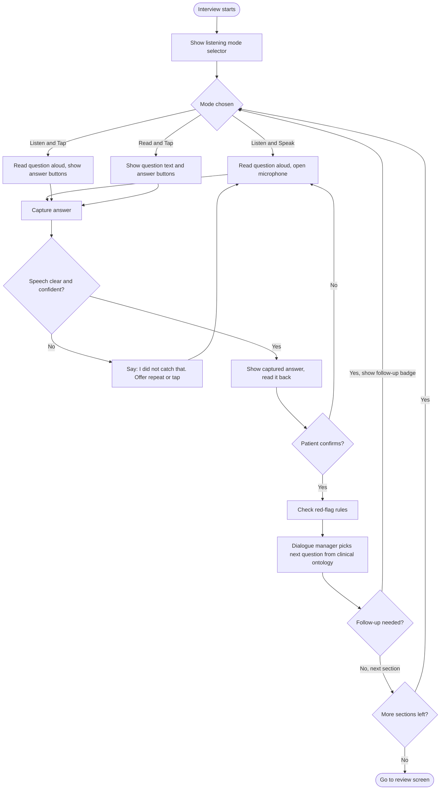

### 8.5 Handling poor speech recognition

- Critical answers (allergies, medicines, emergency symptoms) are always confirmed **visually and by audio**, so a recognition error cannot silently hide a red flag.
- If recognition fails twice, the screen automatically offers tapping, and if that also fails it alerts staff.
- If the patient switches language mid-session, earlier answers are kept and shown in the new language.

### 8.6 Red-flag alert sequence

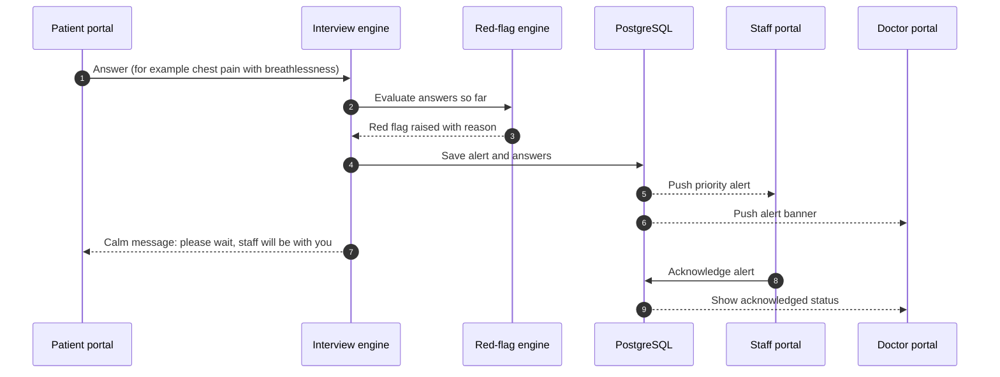

---

## 9. Doctor dashboard

### 9.1 Design goals

- **See who needs attention first:** emergency alerts and readiness at the top.
- **Understand a patient in seconds:** one summary screen, details one tap away.
- **Trust but verify:** every item shows its source file or answer.
- **Minimal clicks:** accept, amend or reject inline; keyboard shortcuts for common actions.
- **Comfortable to read:** clear hierarchy, large text option, English, Hindi or Marathi.

### 9.2 Dashboard wireframe: today's queue

```
+-----------------------------------------------------------------------------+
| PatientCase_AI   Dr. A. Sharma | OPD Medicine       [🔍 Search]  [EN|हिं|मरा] |
+-----------------------------------------------------------------------------+
| 🚨 ALERT: Token 14  Rakesh K., 58 M  chest pain + breathlessness  [Open now] |
+-----------------------------------------------------------------------------+
| Waiting: 12 | In intake: 4 | Ready: 8 | Alerts: 1 | Completed today: 23      |
+--------------------------------+--------------------------------------------+
| QUEUE            [All|Ready|⚠] | SELECTED PATIENT SUMMARY                   |
|                                |                                            |
| 🔴 14 Rakesh K.  58 M          | Rakesh K., 58 M   Language: Marathi        |
|    Chest pain      READY       | Complaint: Chest pain 40 min  Token 14     |
|                                |                                            |
| 🟢 15 Sunita P.  34 F          | [Summary] [Documents] [Labs] [Meds] [Timeline]
|    Fever 3 days    READY       | ------------------------------------------ |
|                                | Chief complaint   ...              [✎]     |
| 🟡 16 Anil D.    41 M          | HPI               ...              [✎]     |
|    Back pain   IN INTAKE 60%   | Past history      ...              [✎]     |
|                                | Drugs & allergy   ⚠ Penicillin allergy    |
| ⚪ 17 Meena S.   67 F          | Family / Personal ...                     |
|    Not started                 | ROS               ...                      |
|                                | Prior investigations  (4 files)  view      |
+--------------------------------+--------------------------------------------+
|  ⚠ 2 abnormal labs  |  ⚠ 1 interaction flag  |  ⚠ 1 record mismatch           |
|                    [Reject]   [Amend]   [Accept & sign]   [Export / push]     |
+-----------------------------------------------------------------------------+
```

### 9.3 Patient workspace tabs

| Tab | Contents |
|---|---|
| **Summary** | Standard-format summary with inline edit, source tags and completeness indicator |
| **Documents** | All uploaded files with thumbnails; original image beside extracted fields; confidence badges |
| **Labs** | Consolidated lab table across files and dates; out-of-range highlighted; direction of change; filter by test |
| **Medications** | Merged medication list from all files and the patient's answers; duplicates merged; interaction flags; allergy conflicts |
| **Timeline** | Chronological view of every document and event, with source file |
| **Alerts and checks** | Red flags, record mismatches, conflicts between documents and patient answers |

### 9.4 Dashboard requirements

| ID | Requirement | Priority |
|---|---|---|
| DB-1 | Show today's queue ordered by priority (alerts first), then token order, with status chips: Not started, In intake, Ready, Alert, In consultation, Completed. | M |
| DB-2 | Show a persistent alert banner for emergency flags with one-click open. | M |
| DB-3 | Show summary counters (waiting, in intake, ready, alerts, completed). | S |
| DB-4 | Open a split-view workspace: queue on the left, selected patient on the right. | M |
| DB-5 | Show the standard-format summary with inline edit and clear Accept, Amend and Reject actions; record the doctor's decision and time. | M |
| DB-6 | Show warning chips (abnormal labs, interaction flags, record mismatches, allergies) that jump to the relevant tab. | M |
| DB-7 | Show the original scan beside each extracted value. | S |
| DB-8 | Search and filter the queue by name, token, complaint, status or alert. | S |
| DB-9 | Switch the physician-facing language between English, Hindi and Marathi. | M |
| DB-10 | Provide keyboard shortcuts (next patient, accept, toggle tabs) and a large-text option. | S |
| DB-11 | Export or print the confirmed summary, and push it to HIS and ABHA. | M |
| DB-12 | Show a completeness indicator that lists what the patient did not answer ("not answered" is never shown as "no"). | S |
| DB-13 | Show who edited what and when, with the AI draft preserved. | S |

### 9.5 Case status lifecycle

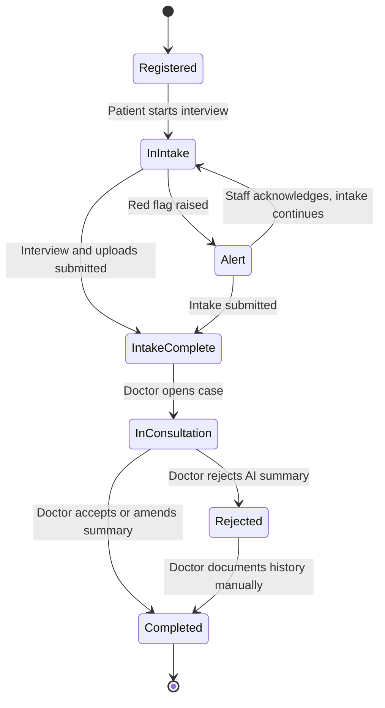

### 9.6 Doctor review sequence

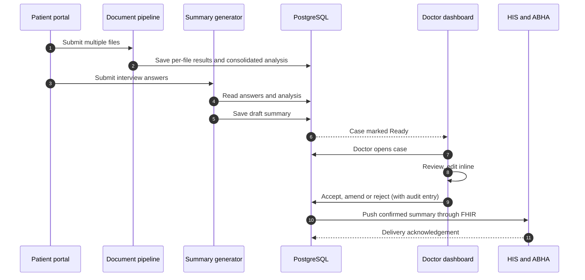

---

## 10. Non-functional requirements

| Area | Requirement | Basis |
|---|---|---|
| Usability | Zero training for a first-time patient; icon-driven; audio guidance in the chosen language. | Source 2.3 |
| Languages | English, Hindi and Marathi for UI, speech recognition, speech output, OCR and summaries. | CR3 |
| Accessibility | Large touch targets (at least 64 px for patient screens), high contrast, adjustable audio volume and speech speed, large-text option. Consider hearing and speech impairment (Open Questions). | Proposed |
| Speech robustness | Operate in noisy hospital environments and across accents. | Source 2.3 |
| Scalability | Support hospitals with 4,000 to 10,000 OPD patients a day with many simultaneous terminals and multi-file uploads. | Source 1.1, 2.2 |
| Performance | Natural-feeling speech-to-next-question latency; per-file progress visible; summary ready before the patient is called. Numeric targets set during benchmarking. | Proposed |
| Reliability | Graceful behaviour when speech, OCR or network is poor; session recovery after interruption; partial results kept if one file fails. | Proposed |
| Security | Secure processing within the platform; TLS in transit; encryption at rest; role-based access across three portals; secure sessions; multi-factor option for staff and doctors. | Source 3.3 plus proposed controls |
| Privacy | Consent first; granular and revocable consent; immediate clearing of temporary session data; data minimization. | Source 3.3 |
| Database | **PostgreSQL** is the system of record (Section 12). | CR10 |
| Interoperability | FHIR-based exchange with ABDM and the HIS or EMR. | Source 1.2, 3.3 |
| Auditability | Logs for consent, access, edits and alerts. | Proposed |
| Maintainability | Configurable question sets and ontology per specialty and AYUSH; language models and rules updateable without redeploying the whole platform; database changes through versioned migrations. | Proposed |
| Availability | Hospital-hours availability; monitored health of speech, OCR, database and integrations; offline behaviour is an open question. | Proposed |

---

## 11. System architecture

### 11.1 System context

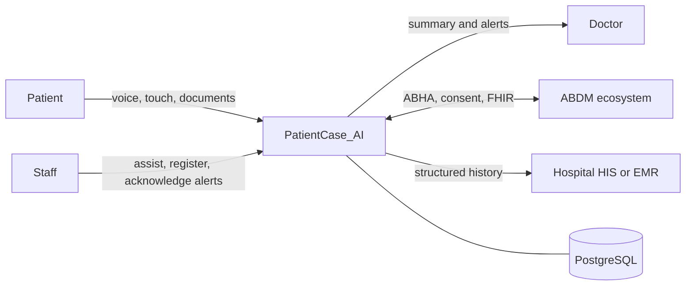

### 11.2 Logical architecture

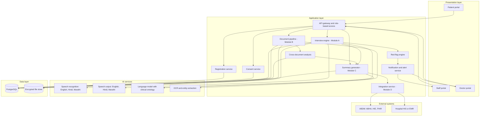

### 11.3 Component responsibilities

| Component | Responsibility |
|---|---|
| Patient, Staff, Doctor portals | Three separate front-ends with role-specific screens |
| API gateway and role-based access | Authentication, authorization per portal, request logging |
| Registration service | Self-registration, OTP, duplicate detection, ID creation |
| Consent service | Capture, store and revoke consent; audit |
| Interview engine (A) | Adaptive questioning governed by the clinical ontology; listening modes; AYUSH mode |
| Red-flag engine | Detect emergency symptoms and raise priority alerts |
| Document pipeline (B) | Multi-file intake, quality checks, OCR, classification, extraction |
| Cross-document analysis | Timeline merge, medication reconciliation, consolidated labs, interaction and consistency checks |
| Summary generator (C) | Merge interview and analysis into the standard summary with sources |
| Integration service (D) | FHIR/ABDM, HIS adapter, ABHA PHR linking |
| Notification service | Real-time alerts to staff and doctor portals |
| PostgreSQL | System of record for structured data |
| Encrypted file store | Original scans and temporary working files, referenced from PostgreSQL |

### 11.4 Deployment view (proposed)

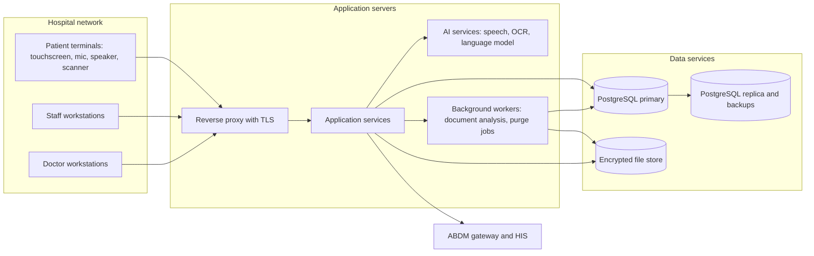

---

## 12. Data design (PostgreSQL)

### 12.1 Why PostgreSQL

- Reliable relational integrity for patients, encounters, consent and audit.
- **JSONB** columns hold flexible history answers and FHIR resources alongside relational columns.
- Row-level security can enforce portal and department boundaries inside the database.
- Mature tooling for backup, point-in-time recovery, replication and encryption.
- Extensions for fuzzy matching (for duplicate patient detection) and scheduled jobs (for purging temporary data).

### 12.2 Entity relationship diagram

```mermaid
erDiagram
    USERS ||--o{ AUDIT_LOGS : "performs"
    PATIENTS ||--o{ PATIENT_IDENTIFIERS : "has"
    PATIENTS ||--o{ CONSENTS : "gives"
    PATIENTS ||--o{ ENCOUNTERS : "has"
    ENCOUNTERS ||--o{ INTERVIEW_RESPONSES : "records"
    ENCOUNTERS ||--o{ DOCUMENTS : "includes"
    ENCOUNTERS ||--o{ ALERTS : "raises"
    ENCOUNTERS ||--o{ QUEUE_ENTRIES : "queued as"
    ENCOUNTERS ||--o{ SUMMARIES : "produces"
    ENCOUNTERS ||--o{ ANALYSIS_RESULTS : "yields"
    DOCUMENTS ||--o{ EXTRACTED_ENTITIES : "contains"
    DOCUMENTS ||--o{ LAB_RESULTS : "contains"
    DOCUMENTS ||--o{ MEDICATIONS : "lists"
    SUMMARIES ||--o{ SUMMARY_VERSIONS : "revised as"
    USERS ||--o{ SUMMARY_VERSIONS : "edits"
    DEPARTMENTS ||--o{ USERS : "employs"

    USERS {
        uuid id PK
        text role "staff, doctor, admin"
        text full_name
        uuid department_id FK
        timestamptz created_at
    }
    DEPARTMENTS {
        uuid id PK
        text name
        boolean ayush
    }
    PATIENTS {
        uuid id PK
        text patientcase_id UK
        text full_name
        date date_of_birth
        text sex
        text mobile_hash
        text preferred_language "en, hi, mr"
        timestamptz created_at
    }
    PATIENT_IDENTIFIERS {
        uuid id PK
        uuid patient_id FK
        text type "abha, aadhaar_ref, hospital_uhid"
        text value_encrypted
    }
    CONSENTS {
        uuid id PK
        uuid patient_id FK
        jsonb scope "granular purposes"
        text language
        timestamptz given_at
        timestamptz revoked_at
    }
    ENCOUNTERS {
        uuid id PK
        uuid patient_id FK
        uuid department_id FK
        text status "registered, in_intake, alert, ready, in_consultation, completed"
        text listening_mode "listen_speak, listen_tap, read_tap"
        timestamptz started_at
        timestamptz submitted_at
    }
    INTERVIEW_RESPONSES {
        uuid id PK
        uuid encounter_id FK
        text question_key
        jsonb answer
        text modality "voice, tap"
        numeric confidence
        boolean confirmed
    }
    DOCUMENTS {
        uuid id PK
        uuid encounter_id FK
        text doc_type
        text storage_ref
        text status "waiting, reading, done, needs_attention"
        numeric ocr_confidence
        date document_date
    }
    EXTRACTED_ENTITIES {
        uuid id PK
        uuid document_id FK
        text entity_type "diagnosis, procedure"
        text value
        numeric confidence
    }
    LAB_RESULTS {
        uuid id PK
        uuid document_id FK
        text test_name
        numeric value
        text unit
        numeric ref_low
        numeric ref_high
        text flag "low, high, normal, range_unavailable"
        date result_date
    }
    MEDICATIONS {
        uuid id PK
        uuid document_id FK
        text name
        text dose
        text frequency
        date prescribed_on
    }
    ANALYSIS_RESULTS {
        uuid id PK
        uuid encounter_id FK
        text kind "timeline, med_reconciliation, lab_table, interactions, consistency"
        jsonb payload
        timestamptz created_at
    }
    ALERTS {
        uuid id PK
        uuid encounter_id FK
        text rule_id
        jsonb evidence
        timestamptz raised_at
        uuid acknowledged_by FK
        timestamptz acknowledged_at
    }
    QUEUE_ENTRIES {
        uuid id PK
        uuid encounter_id FK
        int token_number
        int priority
        timestamptz created_at
    }
    SUMMARIES {
        uuid id PK
        uuid encounter_id FK
        text status "draft, confirmed, rejected"
        text language "en, hi, mr"
    }
    SUMMARY_VERSIONS {
        uuid id PK
        uuid summary_id FK
        uuid edited_by FK
        jsonb content "standard sections with sources"
        timestamptz created_at
    }
    AUDIT_LOGS {
        uuid id PK
        uuid user_id FK
        text action
        text object_type
        uuid object_id
        timestamptz at
    }
```

### 12.3 PostgreSQL design requirements

| ID | Requirement | Priority |
|---|---|---|
| DBR-1 | Use PostgreSQL as the system of record for all structured data. | M |
| DBR-2 | Use UUID primary keys, `TIMESTAMPTZ` for all times, and foreign keys with constraints for referential integrity. | M |
| DBR-3 | Store flexible interview answers, analysis payloads and FHIR resources as `JSONB` with GIN indexes where queried. | S |
| DBR-4 | Keep original scans in an encrypted file store and reference them from the `documents` table; do not keep large binaries in database rows. | S |
| DBR-5 | Encrypt sensitive fields (identifiers, mobile numbers) at the field level and encrypt storage at rest. | M |
| DBR-6 | Enforce row-level security so a role and department can only read its own patients' data. | S |
| DBR-7 | Hold temporary session data (raw audio, temporary images, working files) in dedicated tables or storage with a time-to-live, and delete it immediately on submission through a purge job (FR-D7). | M |
| DBR-8 | Partition `audit_logs` by time and make it append-only for application users. | S |
| DBR-9 | Use fuzzy-matching support for duplicate patient detection (name, mobile, age). | S |
| DBR-10 | Manage schema changes with versioned migrations. | M |
| DBR-11 | Use connection pooling, indexes on queue and status queries, and a read replica for reporting. | S |
| DBR-12 | Back up with point-in-time recovery, test restores regularly, and define retention in line with DPDP Act 2023 and ABDM consent terms. | M |
| DBR-13 | Store language as a controlled value (`en`, `hi`, `mr`) so all three languages are first class. | M |

### 12.4 Consent and session lifecycle

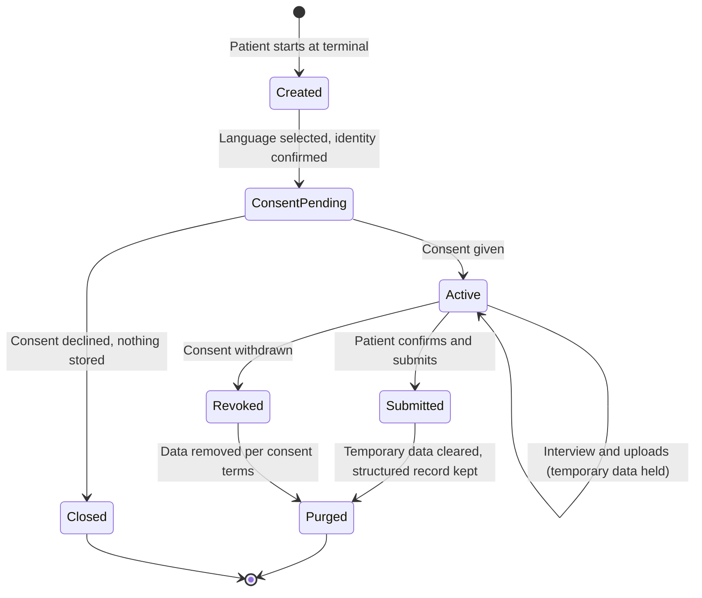

---

## 13. Integrations and external dependencies

| Dependency | Purpose | Notes |
|---|---|---|
| ABDM: ABHA IDs | Patient identification, optional ABHA creation, record linking | Needs access to ABDM interfaces and sandbox |
| ABDM: Health Information Exchange and FHIR APIs | Standards-based exchange of structured data | Defines the output format |
| ABDM consent framework | Consent artefacts for data sharing | Drives consent design |
| Hospital HIS or EMR | Receive the structured history and show it to the doctor | Vendors and interfaces vary by hospital |
| Speech recognition (English, Hindi, Marathi) | Voice input | Bhashini and AI4Bharat models are named in the statement |
| Speech output (English, Hindi, Marathi) | Question prompts and confirmations | Must match ASR languages |
| Large language model | Conversational elicitation, structuring, summarization | Operates inside the clinical ontology; never diagnoses autonomously |
| OCR and document AI | Printed and handwritten recognition in English, Hindi, Marathi | Benchmark on real Indian prescriptions |
| SMS or OTP service | Mobile verification at registration | Provider to be chosen |
| PostgreSQL | System of record | Hosting model is an open question |
| Terminal hardware | Touchscreen, mic, speaker, scanner or camera | Form factor is an open question |

---

## 14. Compliance, privacy and consent

The statement requires compliance with the **Digital Personal Data Protection Act 2023** and the **ABDM consent framework**. This section lists product behaviours that support those obligations. It is not legal advice; obtain legal review before deployment.

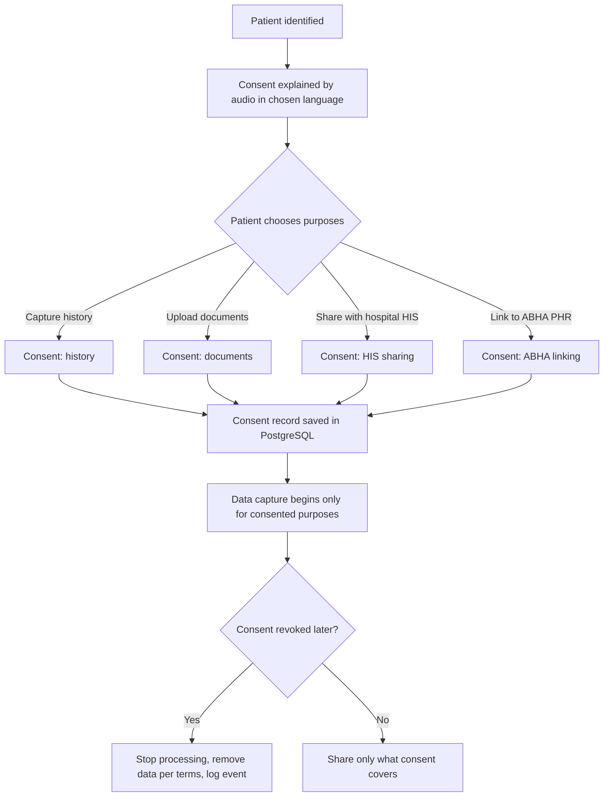

| Principle | Product behaviour |
|---|---|
| Consent first | No data is captured before explicit consent; consent is explained in audio. |
| Granular and revocable | Separate choices for history, documents, HIS sharing and ABHA linking; withdrawal is honoured downstream. |
| Purpose limitation and minimization | Collect only what the consultation needs; share only what consent covers. |
| Secure processing | Voice and document AI are processed securely within the platform. |
| Session termination | Temporary session data is cleared immediately after submission. |
| Transparency | The patient can see, in their language, what is captured and where it goes. |
| Accountability | Consent, access and edit events are logged. |
| Clinical safety | The summary is a draft for the physician; no autonomous diagnosis. |
| Role separation | Patients never see analysis results; staff and doctors see only what their role allows. |

---

## 15. User experience principles

- **Zero training.** A first-time patient succeeds with only on-screen and audio guidance.
- **Voice or touch, always.** Every step supports both, and the patient can switch at any time.
- **One thing at a time.** One question per screen, large icons with labels, plain language.
- **Hear it if you want.** The listening-mode icons let the patient choose voice or text, and the choice carries into every follow-up question.
- **Confirm what matters.** Read back allergies, medicines and key symptoms for confirmation.
- **Never leave the patient stuck.** Poor speech or scanning leads to a touch alternative or the help button.
- **Files are forgiving.** Patients can add, remove, retake and reorder files, and see each file's progress.
- **Respect the clinician's time.** One concise structured screen with sources one tap away.
- **Language parity.** English, Hindi and Marathi get the same quality of prompts, audio and confirmation.
- **Role-appropriate views.** Each portal shows only what that role needs.

---

## 16. Assumptions, constraints and risks

### 16.1 Assumptions

- The platform runs on hospital-provided terminals with touchscreen, audio and scanning or camera capability.
- The hospital can provide a network path for HIS, ABDM and OTP integration.
- Patients can be identified by ABHA ID, Aadhaar details, mobile OTP or new registration.
- Physicians will review an AI-drafted summary and use the edit and confirm controls.

### 16.2 Constraints

- The AI output must never be an autonomous diagnosis (statement section 3.3).
- Compliance with the DPDP Act 2023 and the ABDM consent framework is mandatory.
- The experience must work for low-literacy, elderly and first-time users.
- Languages are limited to English, Hindi and Marathi in this version.
- PostgreSQL is the database.

### 16.3 Risks and mitigations

| Risk | Impact | Mitigation |
|---|---|---|
| Speech recognition quality varies, especially for Marathi and regional accents | Wrong or missing history | Always offer tap input; confirm critical answers visually and by audio; benchmark per language; native-speaker review |
| Handwritten OCR is unreliable for Hindi and Marathi | Wrong medications or values reach the doctor | Confidence indicators; manual review path; always show the source image |
| Multi-file analysis is slow or one file fails | Delays; incomplete picture | Parallel processing; per-file status; partial results; summary states which files were included |
| Wrong-patient or mixed-up documents in the upload | Incorrect combined analysis | Identity consistency checks; doctor sees mismatch warnings; patient can remove files |
| AI summary contains incorrect content | Clinical risk | Ontology constraints; sources per item; mandatory physician accept, amend or reject; no diagnosis |
| Red-flag detection misses or over-alerts | Patient harm or alert fatigue | Clinician-reviewed rules; err towards alerting; test on emergency scenarios; staff feedback |
| Role boundary failure between portals | Privacy breach | Role-based access, row-level security, access logging, penetration testing |
| Self-registration creates duplicate or false identities | Fragmented records | OTP verification, duplicate matching, staff confirmation for uncertain matches |
| Low literacy users abandon the process | Low adoption | Listening-mode icons, zero-training design, help button, staff-assist |
| Database failure or data loss | Loss of patient data | Replication, point-in-time recovery, tested restores |
| HIS or ABDM integration is slow or inconsistent | Delayed rollout | Standards-based FHIR adapter, early sandbox work, configurable HIS connectors |
| Physicians do not trust or use the summary | No time saved | Show sources, fast edit, pilot with clinicians, measure edit rate |

---

## 17. Open questions

| # | Question | Why it matters |
|---|---|---|
| Q1 | What belongs in section 3.2 of the problem statement ("Insert Table")? | May contain requirements missing here |
| Q2 | Is the deliverable a physical kiosk or software for existing hospital terminals? | Hardware, deployment and scanning approach |
| Q3 | Offline or poor-connectivity behaviour? | Rural and public hospitals may have unreliable networks |
| Q4 | Are imaging films in scope? Section 1.2 mentions them but Module B lists prescriptions, lab reports and discharge summaries. | Document pipeline scope |
| Q5 | How are patients who cannot self-report handled (children, cognitively impaired, hearing or speech impaired)? | Accessibility and consent |
| Q6 | Which HIS or EMR products must be supported? | Integration design |
| Q7 | Success metrics and targets? | None in the statement; Section 4.3 needs agreement |
| Q8 | Who validates the question ontology, AYUSH content, icon labels and red-flag rules clinically? | Clinical safety |
| Q9 | Who is the data fiduciary, and where is data processed and stored? Is PostgreSQL on-premises or in a cloud region in India? | DPDP Act and ABDM obligations |
| Q10 | Maximum files, file size and pages per upload? Section 7.3 proposes limits. | Capacity and performance |
| Q11 | Which OTP or SMS provider, and is on-site ABHA creation allowed for new patients? | Registration flow |
| Q12 | Which Marathi and Hindi variants or dialects should be supported? | Speech and OCR quality |
| Q13 | Should the physician summary offer Marathi in addition to the statement's English and Hindi? (This PRD assumes yes.) | Language scope |

---

## 18. Proposed delivery phasing

The statement does not prescribe phases. This is a proposal.

| Phase | Scope | Outcome |
|---|---|---|
| **1. Core journey** | Three portals with role access (P1 to P5); self-registration (R1 to R6, R9); consent (D1 to D3, D6, D7); voice and touch interview in English, Hindi and Marathi with listening-mode icons (A1 to A13); red flags (A16, T1, T2); multi-file upload with per-file OCR and extraction (B1 to B7); summary (C1 to C5); doctor dashboard core (DB-1 to DB-6, DB-9, DB-11); PostgreSQL schema and migrations | A working end-to-end journey for the main OPD flow |
| **2. Depth and interoperability** | Cross-document analysis (B8 to B12); handwritten OCR tuning and confidence review (B13, B14); AYUSH mode (A14, A15); ABHA PHR linking through FHIR (D5); OTP and duplicate detection (R4, R5, R7); dashboard tabs for labs, meds and timeline; compliance hardening (D8 to D10) | Clinical depth and full ABDM integration |
| **3. Scale and refinement** | Multi-terminal scaling; row-level security and read replicas; admin console (P6); analytics on completion, edit rate and time saved; accessibility and staff-assist improvements; clinician feedback loop | Hospital-wide rollout readiness |

Section 22 breaks this proposal into eleven build phases, each with a detailed description and a Definition of Done.

---

## 19. Acceptance criteria

| Area | The product is acceptable when |
|---|---|
| Registration | A new patient registers unaided by voice or touch in English, Hindi or Marathi, verifies their mobile, and receives a PatientCase ID; a likely duplicate is caught and confirmed before a new record is created. |
| Portals | Patients, staff and doctors each sign in to their own separate portal and cannot open another role's pages or data; patients never see analysis results. |
| Module A | A new patient completes a voice or touch interview with no training; the listening-mode icons let them choose to hear or not hear questions and the choice applies to follow-up questions; follow-ups adapt to the chief complaint; every question can be answered by speaking or tapping; AYUSH mode captures all listed Dashavidha Pariksha parameters; an emergency symptom produces a visible priority alert on the staff and doctor screens. |
| Module B | A patient uploads several files in one session and sees per-file status; each file is digitized; diagnoses, medications with dosages, lab values with ranges and procedures are extracted; all files appear in one chronological timeline; medications are reconciled across files; a consolidated lab table flags out-of-range values and shows direction of change; interactions and consistency mismatches are flagged; low-confidence items are marked for review. |
| Module C | One summary in the standard section order appears on the doctor dashboard when the patient is called; it draws on the interview and all uploaded files; the physician can accept, amend or reject it; the patient hears audio confirmation in their language; the physician can view the summary in English, Hindi or Marathi; the summary makes no diagnosis. |
| Doctor dashboard | The doctor sees a priority-ordered queue, an alert banner, a split-view workspace, warning chips, and inline accept, amend and reject actions, and can search, filter and export. |
| Module D | The patient authenticates with ABHA, Aadhaar, OTP or new registration; consent is captured, explained in audio, granular and revocable; structured data reaches the HIS and the ABHA PHR through FHIR; temporary session data is cleared after submission. |
| Database | All structured data is stored in PostgreSQL with versioned migrations, encryption of sensitive fields, an append-only audit log, tested backup and restore, and a working purge job for temporary data. |
| Compliance | A review confirms conformance with the DPDP Act 2023 and the ABDM consent framework. |
| Overall | The full journey (Identify or register, Converse, Scan, Summarize and Route, Consult) completes before the consultation with minimal staff assistance, and the physician reports having a usable history when the patient arrives. |

---

## 20. Traceability

### 20.1 Problem statement to requirements

| Statement section | Topic | Covered by |
|---|---|---|
| 1.1 | History-taking bottleneck; AYUSH complexity | Section 3.1; FR-A4, A5, A14, A15 |
| 1.2 | Records fragmentation; ABDM first-mile gap | Section 3.2; FR-B1 to B15; FR-D1, D4, D5 |
| 1.3 | Opportunity and enabling technologies | Section 3.3; Section 13 |
| 2.1 | Problem definition | Section 3.4; Section 4.1 |
| 2.2 | Why existing solutions fall short | Section 3.5; Section 4.2 |
| 2.3 | Challenges C1 to C5 | Section 3.6; FR-A3, A7, A8, A12, A13; FR-B3, B5; FR-D2, D3, D8, D9 |
| 3.1 | Solution overview | Sections 1 and 6 |
| 3.2 | Placeholder "Insert Table" | Open Question Q1 |
| 3.3 Module A | Conversational multimodal history engine | FR-A1 to A18; Section 8 |
| 3.3 Module B | Document digitization and intelligence | FR-B1 to B15; Section 6.4 |
| 3.3 Module C | Structured history summary generator | FR-C1 to C7; Section 9 |
| 3.3 Module D | Consent, privacy, ABDM integration | FR-D1 to D10; Section 14 |
| 3.4 | End-to-end patient journey | Section 6.2; FR-R, FR-P, FR-T |

### 20.2 Change requests to this PRD

| Change request | Sections |
|---|---|
| CR1 Markdown file | This document |
| CR2 Name PatientCase_AI | All |
| CR3 English, Hindi, Marathi | FR-A3, A7, A8, B3, C5, D3; Sections 8, 10, 12 (DBR-13) |
| CR4 Multiple file upload and combined analysis | FR-B1 to B15; Section 6.4 |
| CR5 Voice conversation and listening-mode icons | FR-A8 to A11; Section 8 |
| CR6 Separate pages for Patients, Staff, Doctors | Section 5; FR-P1 to P6 |
| CR7 New patient self-registration | FR-R1 to R9; Section 6.3 |
| CR8 User-friendly doctor dashboard | Section 9; DB-1 to DB-13 |
| CR9 Diagrams and flowcharts | Sections 5, 6, 8, 9, 11, 12, 14 |
| CR10 PostgreSQL | Section 12; DBR-1 to DBR-13 |

---

## 21. Glossary

| Term | Meaning |
|---|---|
| ABDM | Ayushman Bharat Digital Mission |
| ABHA | Ayushman Bharat Health Account, a patient's health ID |
| Agni | Digestive capacity in Ayurveda |
| Ahara-Vihara | Diet and lifestyle assessment in Ayurveda |
| ASR | Automatic speech recognition |
| AYUSH | Ayurveda, Yoga and Naturopathy, Unani, Siddha and Homeopathy |
| Dashavidha Pariksha | Ten-fold examination in Ayurveda: Prakriti, Vikriti, Sara, Samhanana, Pramana, Satmya, Sattva, Ahara Shakti, Vyayama Shakti, Vaya |
| DPDP Act 2023 | Digital Personal Data Protection Act 2023 |
| EMR / HIS | Electronic medical record / hospital information system |
| FHIR | Fast Healthcare Interoperability Resources, a health data exchange standard |
| HPI | History of present illness |
| JSONB | PostgreSQL's binary JSON column type |
| Koshtha | Bowel nature in Ayurveda |
| Listening mode | The patient's choice to hear questions aloud or read them (Section 8) |
| Nidana / Samprapti | Causative factors / pathogenesis in Ayurveda |
| OCR | Optical character recognition |
| OPD | Outpatient department |
| OTP | One-time password |
| PHR | Personal health record |
| Prakriti / Vikriti | Constitution / current imbalance in Ayurveda |
| ROS | Review of systems |
| SOCRATES | Pain-history framework: Site, Onset, Character, Radiation, Associations, Time course, Exacerbating or relieving factors, Severity |
| TTS | Text-to-speech |

---

## 22. Detailed development plan

Section 18 groups delivery into three release-level phases. This section is the engineering sequence behind them: eleven build phases, each with a detailed description of what is built and a **Definition of Done** that says exactly when the phase is finished. Effort figures are estimates for **one developer working part-time**; adjust them to the team size. Days are working days.

### 22.1 Summary

| Phase | Name | Est. effort | Depends on | Result | Requirements closed |
|---|---|---|---|---|---|
| **0** | Foundation | 3 to 4 days | None | Repo, PostgreSQL schema, auth, three portal shells, language framework | 5 |
| **1** | Registration, identity and consent | 4 to 5 days | Phase 0 | New and returning patients can register and consent | 14 |
| **2** | Voice and touch interview | 7 to 9 days | Phases 0 and 1 | Adaptive interview in English, Hindi and Marathi with listening-mode icons | 16 |
| **3** | Red flags and triage | 3 to 4 days | Phase 2 | Emergency alerts reach staff and doctor in real time | 4 |
| **4** | Multi-file document pipeline | 5 to 7 days | Phase 2 | Several files uploaded, read and extracted with per-file status | 10 |
| **5** | Cross-document analysis | 5 to 6 days | Phase 4 (and the answers from Phase 2) | Timeline, medication reconciliation, lab table, interaction and consistency checks | 6 |
| **6** | Summary and doctor dashboard | 6 to 8 days | Phases 2, 3 and 5 | Physician-ready summary on a usable dashboard | 21 |
| **7** | AYUSH mode | 3 to 4 days | Phase 2 | Dashavidha Pariksha interview | 2 |
| **8** | Integration and compliance hardening | 5 to 7 days | Phases 1 and 6 | FHIR and ABHA linking, HIS push, security hardening | 13 |
| **9** | Testing, evaluation and pilot | 5 to 7 days | Phases 7 and 8 (and everything before) | Measured accuracy, usability results, acceptance sign-off | 0 |
| **10** | Scale and rollout | 3 to 5 days | Phase 9 | Admin console, monitoring, backups, training | 2 |
| | **Total** | **49 to 66 days** | | | **93** |

Together that is roughly **10 to 13 weeks solo** (at five working days a week), or about 5 to 7 weeks with a team of three or four working in parallel.

### 22.2 Sequencing and parallel work

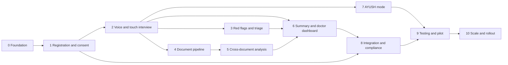

- **Order.** Phases 0, 1 and 2 come first. Phases 3 and 4 can run in parallel after Phase 2. Phase 5 needs Phase 4. Phase 6 needs Phases 2 and 5, and also reuses the alert banner from Phase 3. Phase 7 needs only Phase 2, so it can run alongside Phases 3 to 6 once the clinical content is ready.
- **Early starts.** ABDM sandbox access, translation review, clinical content authoring (including the AYUSH content) and a test-data set of synthetic prescriptions and lab reports all have long lead times. Start them in Phase 0.
- **Hackathon cut.** If time is short, build Phases 0 to 3, a basic Phase 4 and the core of Phase 6. That gives a demonstrable end-to-end flow, and the rest can be presented as the roadmap.

### 22.3 How Definition of Done works

A phase is **Done** only when **every** item in its own Definition of Done is true **and** every applicable common criterion below is true. Each item names how it is verified, so that "done" is a checked fact and not an opinion. Items that need a number (for example an alert latency or a usability sample size) are marked as proposals; fix the actual value during the phase and record it.

**Common criteria** (in addition to each phase's own items):

| ID | Criterion | Applies to |
|---|---|---|
| C1 | Every requirement assigned to the phase is implemented, and each has at least one passing automated test or a documented manual check. | All except 9 |
| C2 | Code is reviewed and merged to the main branch, and CI is green (unit tests, integration tests, build and migration check). | All phases |
| C3 | Database changes are versioned migrations that apply cleanly to a fresh database and to the previous release. | All except 9 |
| C4 | Every user-facing string exists in English, Hindi and Marathi. Text still awaiting native-speaker review is marked as pending. | Phases 0, 1, 2, 3, 4, 6 and 7 |
| C5 | Patient-facing screens keep a 64 px minimum touch target, an icon with a text label, and an audio cue on selection (Section 8.3). | Phases 1, 2, 3, 4, 6 and 7 |
| C6 | New endpoints enforce role checks, and Patient-portal responses expose no analysis results, flags or alert levels. | All except 0 and 9 |
| C7 | Consent, access and edit events created by the phase are written to the audit trail. | All except 0 and 9 |
| C8 | No Severity 1 or Severity 2 defect is open, and known issues are listed. | All phases |
| C9 | The phase is demonstrated on staging with synthetic data to the product owner, and to a clinical reviewer where the phase notes call for one. Real patient data is not used before the Phase 9 pilot. | All except 9 |
| C10 | Documentation (README, runbook, API notes) and the tracking spreadsheet are updated. | All phases |

**Ways of verifying.** *Automated test*: a repeatable test that runs in CI. *Demo*: shown working on staging to the product owner. *Review*: a named person inspects and signs. *Clinician review* or *sign-off*: a clinician checks the content or behaviour. *Measured test*, *Benchmark report*, *Load test*: a recorded measurement. *Usability test*: observed sessions with real users. *Security test*, *Restore test*, *Failure drill*, *Restore drill*: a deliberate exercise with a recorded result.

### 22.4 Phase descriptions and definitions of done

#### Phase 0: Foundation

| | |
|---|---|
| **Estimated effort** | 3 to 4 days |
| **Depends on** | None |
| **Outcome** | Repo, PostgreSQL schema, auth, three portal shells, language framework |
| **Requirements closed** | FR-P1, DBR-1, DBR-2, DBR-10, DBR-13 (5) |
| **Also touched** | FR-A3, FR-P2 to P4 |

**Goal.** Create the skeleton that every later phase builds on, so that later phases add features rather than plumbing. Nothing clinical is built here; the aim is a clean, tested base with the three role-separated portals, the database, and the three-language framework in place.

**What gets built**

*Repository, environments and CI*

- Create the repository with a clear structure for the three portals, shared services and a shared UI package.
- Set up development, staging and production configuration, with secrets kept out of the code.
- CI pipeline on every merge: lint, unit tests, build and a database migration check. Protect the main branch.
- Rule for the whole project: development and staging use synthetic data only.

*PostgreSQL schema v1 and migrations*

- Choose a migration tool and make every schema change a versioned migration (DBR-10).
- Create the tables in the Section 12.2 ER diagram with UUID primary keys, TIMESTAMPTZ times and foreign keys (DBR-2).
- Store language as a controlled value (en, hi, mr) enforced by a database constraint, not only by application code (DBR-13).
- Declare the JSONB columns (interview answers, analysis payloads, consent scope, summary content); add indexes later, when real queries exist.
- Seed departments (including one AYUSH department) and one test user per role.

*Role-based authentication*

- Staff and doctor sign-in with credentials and secure sessions, with a hook for optional multi-factor sign-in.
- The gateway maps each role to exactly one portal and rejects everything else (FR-P4, first version).
- Patient sessions are created by the identity flow in Phase 1; until then a temporary test session lets the patient shell be developed.

*Three portal shells*

- Separate addresses /patient, /staff and /doctor, each with its own layout and navigation, plus a landing page with three entries (FR-P1 to P3).
- Patient shell uses a large-touch, one-thing-at-a-time layout; staff and doctor shells use a denser desktop layout.
- Each shell shows role-appropriate placeholder pages only.

*Design system and icon set*

- Design tokens for colour, type size and spacing; a high-contrast theme and a large-text option.
- Components with a minimum 64 px touch target on patient screens, and every icon paired with a text label (Section 8.3).
- Icon set v1 as SVG covering all 14 icons in Section 8.3, with distinct shapes for on, off, active and disabled states. Final artwork can follow.

*Translation framework*

- Key-based strings with no hard-coded text, and English, Hindi and Marathi resource files.
- A language switch that keeps the user's place and state; a Devanagari-capable font stack with rendering checks.
- A review workflow so native speakers and clinicians can approve labels (Section 8.3 asks for this before release).

**Deliverables**

- Repository with CI and one-command local setup.
- Migration set v1 and a schema that matches the Section 12.2 ER diagram.
- Three working portal shells with role-restricted sign-in.
- Design system, icon set v1 and the translation framework with a first label set.
- ABDM sandbox application submitted.

**Risks and watch points**

- ABDM sandbox access can take weeks, so apply on day one. Phases 1 and 8 depend on it.
- Schema changes are cheapest now. Review the ER diagram with the team before Phase 4 starts writing document data.
- The hosting model (Open Question Q9) decides managed or self-hosted PostgreSQL; the schema does not depend on it, but environments do.
- Hindi and Marathi label review has a long lead time. Start it now.

> **Build status (2026-10-31): in progress, built and verified locally.** Items 1 to 5 are met (automated tests and a browser demo; Hindi and Marathi labels are drafts pending review). Open: item 6 (a new developer must try the README), item 7 (ABDM sandbox application and a named Hindi/Marathi review owner, see `docs/phase0-external-actions.md`), and common criteria C2 (CI on a remote repository) and C9 (product-owner demo on staging).

**Definition of Done for Phase 0**

Phase 0 is done when all of the following are true, together with the common criteria in Section 22.3.

- [x] A fresh PostgreSQL database migrates to schema v1 with one command, and the same migrations run in CI on every merge. *(Verified by: automated test)*
- [x] Every table in the Section 12.2 ER diagram exists with UUID keys, TIMESTAMPTZ times and foreign keys, and inserting a language other than en, hi or mr is rejected by the database itself. *(Verified by: automated test)*
- [x] A patient, a staff and a doctor test account can each sign in only to their own portal; a test of all nine role and portal combinations passes. *(Verified by: automated test)*
- [x] All three portal shells load at their own addresses with their own navigation, and the language switch works in each, with Devanagari text rendering correctly. *(Verified by: demo)*
- [x] Patient-screen components meet the 64 px touch target, and all 14 icons from Section 8.3 exist with labels in English, Hindi and Marathi (draft labels accepted). *(Verified by: design review)*
- [ ] A new developer can set up and run the project locally from the README in one sitting. *(Verified by: review)*
- [ ] The ABDM sandbox application is submitted and the Hindi and Marathi review process has a named owner. *(Verified by: review)*

#### Phase 1: Registration, identity and consent

| | |
|---|---|
| **Estimated effort** | 4 to 5 days |
| **Depends on** | Phase 0 |
| **Outcome** | New and returning patients can register and consent |
| **Requirements closed** | FR-R1 to R9, FR-D1 to D3, FR-P5, DBR-9 (14) |
| **Also touched** | FR-D10, FR-P1, FR-P2, DBR-5 |

**Goal.** Let any patient, new or returning, identify themselves and give consent before any clinical data is captured, and leave with a PatientCase ID. Consent comes first in the journey: this phase must be complete before the interview in Phase 2 can store anything.

**What gets built**

*Language and identity entry*

- Language selection first, then a clear choice between 'I am new' and 'I have visited before' (Section 6.3).

*Self-registration*

- Registration by voice or touch with only the minimum fields: name, age or date of birth, sex, mobile and language, with optional address and emergency contact (FR-R1 to R3).
- Mobile OTP behind a provider interface, using a mock provider first. Limit retries, and send the patient to staff help after repeated failure.
- Duplicate detection on name, age and mobile using PostgreSQL fuzzy matching (FR-R5, DBR-9). Show the possible match and ask the patient to confirm; send uncertain matches to staff.
- Create a unique PatientCase ID, and let the patient continue with or without ABHA (FR-R6).

*Returning-patient lookup and ABHA*

- Look up a returning patient by ABHA ID (entered or scanned), Aadhaar details, mobile OTP or PatientCase ID (FR-R9, FR-D1). Hold Aadhaar by reference only, as the aadhaar_ref identifier type in the data model implies.
- Identify and link ABHA against the ABDM sandbox, and offer optional ABHA creation, which the patient can skip (FR-R7).

*Consent*

- Consent screens with an audio explanation in the patient's language (FR-D3).
- Four separate purposes, each given or refused on its own: capture history, upload documents, share with the hospital HIS, link to the ABHA PHR (Section 14).
- Store consent in the consents table with scope, language, given_at and revoked_at. Revocation must work and must be logged (FR-D2, D3).
- Enforce consent in the API: no clinical data can be written for a purpose that has no consent. A declined consent closes the session (Section 12.4).

*Thin speech adapter*

- A basic text-to-speech and speech-recognition wrapper so that voice works for registration and the consent audio. Phase 2 hardens it, benchmarks it and extends it.

*Staff registration on behalf*

- In the staff portal, staff can register a patient on their behalf, with the same duplicate check (FR-R8). This also covers patients who cannot self-report until Open Question Q5 is decided.

*Patient-portal data rule*

- The patient API never returns analysis results, abnormal-value flags or alert levels (FR-P5). Build the response filter now and test it from this phase on.

**Deliverables**

- Patient registration, returning-patient lookup and consent flows in all three languages.
- Consent service with granular, revocable consent and an audit event for every change.
- Duplicate detection and PatientCase ID generation.
- ABHA sandbox integration (or a documented stub if sandbox access is still pending).
- Staff 'register on behalf' screen.

**Risks and watch points**

- The OTP or SMS provider and on-site ABHA creation are undecided (Open Question Q11). The provider interface keeps this open.
- Voice recognition of names is error-prone. Always show the captured name for confirmation and offer an on-screen keyboard.
- Consent wording needs legal review (Section 14). Start the review now so it is not a late blocker.
- Store the mobile number and identifiers only in the hashed and encrypted columns from the start. Key management is hardened in Phase 8.

> **Build status (2026-11-01): in progress, built and verified locally.** Items 2, 3, 4, 6, 8 and 9 are met by automated tests (the ABHA and Aadhaar routes are proven against the documented ABDM stub, because sandbox access is pending). Items 1, 5 and 7 are built and partly shown, but still need a voice demo with a real microphone in each language, an audio check of the consent read-out, and a staff-portal demo to the product owner. Common criteria C2 (CI on a remote repository) and C9 (product-owner demo) are open. Consent wording is a draft awaiting legal review; the OTP provider is a mock.

**Definition of Done for Phase 1**

Phase 1 is done when all of the following are true, together with the common criteria in Section 22.3.

- [ ] A new patient registers unaided, once by voice and once by touch, in each of English, Hindi and Marathi, and receives a PatientCase ID. *(Verified by: demo)*
- [x] OTP verification works with the mock provider, the retry limit is enforced, and repeated failure routes the patient to the staff help call. *(Verified by: automated test)*
- [x] A seeded near-duplicate (same person, spelling variant, same mobile) is caught and must be confirmed before a new record is created, and a clearly different person is not blocked. *(Verified by: automated test)*
- [x] A returning patient is found by each of the four routes: ABHA ID, Aadhaar details, mobile OTP and PatientCase ID. The ABHA route is proven against the ABDM sandbox, or against a documented stub if sandbox access is pending. *(Verified by: automated test)*
- [ ] Consent has four separate purposes, with audio in all three languages. Each can be given or refused, revocation works and is logged, and an attempt to write data for a purpose without consent is rejected by the API. *(Verified by: automated test)*
- [x] Declining consent closes the session and no history or document data is stored. *(Verified by: automated test)*
- [ ] Staff can register a patient on their behalf from the staff portal, and the same duplicate check runs. *(Verified by: demo)*
- [x] Patient-portal API responses contain no analysis results, flags or alert levels. *(Verified by: automated test)*
- [x] Mobile numbers and identifiers are stored only in their hashed or encrypted columns. *(Verified by: review)*

#### Phase 2: Voice and touch interview

| | |
|---|---|
| **Estimated effort** | 7 to 9 days |
| **Depends on** | Phases 0 and 1 |
| **Outcome** | Adaptive interview in English, Hindi and Marathi with listening-mode icons |
| **Requirements closed** | FR-A1 to A13, FR-A17, FR-A18, DBR-3 (16) |
| **Also touched** | FR-A16, FR-D6, FR-D7, FR-P1, DBR-7 |

**Goal.** Deliver Module A's core: a first-time patient completes an adaptive history interview by voice or touch, in English, Hindi or Marathi, with no training. This is the largest phase and the riskiest for speech quality, so benchmark speech early.

**What gets built**

*Listening-mode selector and icon controls*

- The three-card selector (Listen and Speak, Listen and Tap, Read and Tap) with an audio cue on selection, changeable at any time from the header (FR-A9, Section 8.2).
- Persistent per-question controls: listen on or off, repeat, slower, speak, tap, skip, back, next and help, plus the follow-up badge (FR-A10, Section 8.3).
- The chosen mode applies to every adaptive follow-up question, and changing it applies from the next question (FR-A11).

*Speech in three languages*

- Speech recognition and speech output for English, Hindi and Marathi, with a slower speed setting (FR-A7, A8). Evaluate Bhashini, AI4Bharat models and alternatives behind the adapter, so the engine can be swapped.
- Noise handling and confidence thresholds. If recognition fails twice, offer tapping; if that also fails, alert staff (Section 8.5).
- Run a first word-error-rate benchmark on Marathi in the first days of the phase.

*Question bank and clinical ontology*

- Questions for presenting complaints, history of present illness, past medical and surgical history, drug and allergy history, family and personal history, and review of systems (FR-A4).
- Each question has a key, an answer type (yes or no, single choice, multiple choice, number, free text), text and voice prompt in three languages, and branching rules.
- The ontology constrains the dialogue manager (FR-A6). Question sets are configuration, so they can change per specialty without a full redeploy.

*Adaptive dialogue*

- The dialogue manager picks the next question from the ontology using the chief complaint and earlier answers, including SOCRATES for pain (FR-A5).
- The language model maps free narration to ontology fields and asks about missing fields. It never invents answers and never diagnoses.
- Skip records 'not answered' and never 'no'. Mark follow-ups with the follow-up badge.

*Confirmation, review and recovery*

- Read back each captured answer for confirmation. Critical answers (allergies, medicines, emergency symptoms) are confirmed both visually and by audio (Section 8.5, FR-A17).
- A review screen where the patient can see and correct every answer.
- Switching language mid-session keeps all earlier answers, and an interrupted session resumes where it stopped.

*Structured output and storage*

- Convert free narration into the standard physician-readable history structure (FR-A13).
- Save each answer in interview_responses with its modality, confidence and confirmed flag, as JSONB with indexes where queried (DBR-3).

*Help button and hooks for later phases*

- A call-for-help button on every screen that creates a staff alert record (FR-A18). The full staff screen arrives in Phase 3.
- After each confirmed answer, call a red-flag evaluation interface, stubbed for now. Leave an extension point for AYUSH mode.

**Deliverables**

- Interview engine with the listening-mode selector and icon controls.
- Speech adapter with benchmarked recognition and speech output in all three languages.
- Question bank and ontology v1, in three languages, submitted for clinician review.
- Review screen, read-back and session recovery.
- ASR benchmark report (word error rate per language).

**Risks and watch points**

- Marathi speech quality is the top risk (Section 16.3). Benchmark first and keep tapping always available.
- Language-model drift. Constrain it with the ontology, log its inputs and outputs, and test for invented answers.
- Voice recordings are temporary data. Give them a time-to-live now; the purge job is built in Phase 8 (DBR-7).
- Start AYUSH clinician content authoring during this phase so Phase 7 is not blocked.

> **Build status (2026-11-01): in progress, built and verified locally.** Items 2, 3, 4, 6, 7, 8, 9 and 10 are met by automated tests, and the tap interview was run end to end in Marathi in the browser. Still open: item 1 (usability test with real users), item 5 (clinician review of the branching), item 11 (the ASR benchmark: the harness is ready but no recordings have been measured, so there is no Marathi result yet) and item 12 (the ontology and icon labels are generated for review but not yet sent). Voice input is unit tested with fake speech APIs only and has not been tried with a real microphone. Free narration is mapped by a rule-based engine; no language model is connected. Common criteria C2 (CI on a remote repository) and C9 (product-owner and clinical demo) are open.

**Definition of Done for Phase 2**

Phase 2 is done when all of the following are true, together with the common criteria in Section 22.3.

- [ ] First-time users complete the full interview with no training in each language. Run a usability session with a proposed minimum of five users per language, including elderly or low-literacy participants, and record completion without staff help. *(Verified by: usability test)*
- [x] The listening mode changes how every later question appears, including adaptive follow-ups, and a change from the header applies from the next question. *(Verified by: automated test)*
- [x] Every question in the bank can be answered both by speaking and by tapping, checked by an automated pass over the whole bank. *(Verified by: automated test)*
- [x] All icon controls work and carry text labels in three languages. Skip records 'not answered', never 'no'. *(Verified by: automated test)*
- [ ] Follow-up questions differ for at least three chief complaints (for example chest pain, fever, back pain), SOCRATES is used for pain, and a clinician has reviewed the branching. *(Verified by: clinician review)*
- [x] The patient can correct any answer on the review screen. Allergies, medicines and emergency symptoms are always confirmed both visually and by audio. *(Verified by: automated test)*
- [x] Two failed recognitions offer tapping, and a further failure alerts staff. *(Verified by: automated test)*
- [x] Switching language mid-session keeps all earlier answers and shows them in the new language, and an interrupted session resumes where it stopped. *(Verified by: automated test)*
- [x] Free narration is converted to the standard history structure and saved with modality, confidence and confirmed flag. *(Verified by: automated test)*
- [x] The help button on every screen creates a staff alert record. *(Verified by: automated test)*
- [ ] An ASR benchmark report is committed, with word error rate per language under noisy-ward conditions, and the Marathi result was reported in the first week. *(Verified by: benchmark report)*
- [ ] The ontology and the icon labels have been submitted to clinician review, with comments resolved or logged (final sign-off happens in Phase 9). *(Verified by: clinician review)*

#### Phase 3: Red flags and triage

| | |
|---|---|
| **Estimated effort** | 3 to 4 days |
| **Depends on** | Phase 2 |
| **Outcome** | Emergency alerts reach staff and doctor in real time |
| **Requirements closed** | FR-A16, FR-P2, FR-T1, FR-T2 (4) |
| **Also touched** | FR-A18 |

**Goal.** Make sure an emergency symptom never waits in the routine queue: it raises a priority alert on the staff and doctor screens at once, while the patient sees only a calm message. Missing a real emergency is the most serious failure in the product, so this phase errs toward alerting.

**What gets built**

*Red-flag rules*

- Data-driven, versioned rules: a rule id, conditions over answers, a reason, and a version (FR-A16).
- An initial rule set written with clinicians. The PRD names chest pain with breathlessness and stroke symptoms; the clinician reviewer should propose the rest (for example severe bleeding or loss of consciousness).
- Evaluate after every confirmed answer. Treat an unrecognised or skipped critical answer as a reason for staff attention, and err towards alerting (Section 16.3).

*Real-time alert service*

- Save each alert with its rule id and evidence (the triggering answers) in the alerts table, then push it to the staff and doctor portals over a real-time channel such as WebSocket or server-sent events (Section 8.6).
- Reconnect and catch up after a dropped connection, and avoid duplicate alerts for the same rule within one encounter.
- Move the encounter to the Alert status, and record alert events in the audit trail.

*Staff priority screen and queue*

- Alerts shown ahead of routine cases, with the triggering answer visible and an Acknowledge action that records who and when (FR-T1, FR-P2).
- A queue with token number and priority from queue_entries, and help-button requests from Phase 2 shown alongside alerts (FR-A18).
- After acknowledgement the encounter returns to In intake (Section 9.5).

*Doctor alert banner*

- A banner for that doctor's patients, with an Open action and the acknowledged status (FR-T2). The Open target becomes the full patient workspace in Phase 6.

*Patient experience*

- The patient sees a calm message only ('please wait, staff will be with you'), with no alert level or clinical wording (FR-P5).

**Deliverables**

- Red-flag rule format and the first clinician-reviewed rule set.
- Real-time alert service with reconnect and de-duplication.
- Staff priority alert screen and queue, and the doctor alert banner.
- A scripted emergency-scenario test suite.

**Risks and watch points**

- False negatives are the critical risk; alert fatigue is the second. Keep the must-alert and must-not-alert test sets small, agreed with a clinician, and growing.
- The ER diagram links an encounter to a department, not to a specific doctor. Decide how a patient is routed to a doctor. This plan assumes department-level routing until that is decided.
- Real-time connections from many terminals need load testing, which is repeated in Phase 9.

> **Build status (2026-11-01): in progress, built and verified locally.** Items 2 to 6 are met: alert latency was measured at a median of 6 ms and a maximum of 13 ms (12 deliveries, one server, no load; target fixed at 3 seconds), acknowledgement was shown in the browser, the patient sees only a calm message, alerts survive reload and a dropped connection without duplicates, and every alert stores rule id, version and evidence. Open: item 1 (27 scenarios run with zero misses, but they are not yet agreed with a clinician), item 7 (the queue order was shown, the help list on the staff screen has not yet been seen) and item 8 (**the rules are a developer draft; no clinician has reviewed or signed them off**, see `docs/redflag-rules-review.md`). FR-P2 stays open until the staff assist-session and terminal-status screens exist (Phase 10). Common criteria C2 (CI on a remote repository) and C9 (product-owner and clinical demo) are open.

**Definition of Done for Phase 3**

Phase 3 is done when all of the following are true, together with the common criteria in Section 22.3.

- [ ] A scripted emergency-scenario suite (proposed minimum 20 scenarios, mixing must-alert and must-not-alert cases, agreed with a clinician) runs automatically, and every must-alert case raises an alert with zero misses. *(Verified by: automated test)*
- [x] An alert appears on the staff priority screen and on the doctor banner within the agreed latency, and the measured latency is recorded. The PRD says near-immediate, so fix a number in this phase (for example 3 seconds). *(Verified by: measured test)*
- [x] Staff can acknowledge an alert, the doctor banner shows the acknowledged status, and the encounter moves from Alert to In intake. *(Verified by: demo)*
- [x] The patient sees only a calm waiting message, with no alert level and no clinical wording. *(Verified by: automated test)*
- [x] Alerts survive a page reload and a dropped connection, and the same rule firing again in one encounter does not create duplicates. *(Verified by: automated test)*
- [x] Every alert stores its rule id, rule version and evidence. *(Verified by: automated test)*
- [ ] The staff queue orders alerts first, then token order, and help-button requests appear. *(Verified by: demo)*
- [ ] A clinician has reviewed and signed off the red-flag rule set (Phase 9 repeats this review on the final rules). *(Verified by: clinician sign-off)*

#### Phase 4: Multi-file document pipeline

| | |
|---|---|
| **Estimated effort** | 5 to 7 days |
| **Depends on** | Phase 2 |
| **Outcome** | Several files uploaded, read and extracted with per-file status |
| **Requirements closed** | FR-B1 to B7, FR-B13, FR-B14, DBR-4 (10) |
| **Also touched** | FR-D6, FR-D7, DBR-7 |

**Goal.** Let a patient add several paper records in one session and have each one read, classified and turned into structured data, with visible per-file progress. A file that fails must never block the others.

**What gets built**

*Multi-file upload*

- Add files by camera, scanner or file picker, several in one session (FR-B1).
- Accept common image and PDF formats. Read the proposed limits (15 files, 10 MB per file, 10 pages per PDF) from configuration, since Open Question Q10 is still open (FR-B2).

*Validation and quality checks*

- Check type, size, page count and readability on arrival.
- Check image quality (blur, glare, cut-off edges, too dark) and ask the patient to retake or remove a poor file (Section 6.4).

*Per-file status and control*

- Show waiting, reading, done and needs attention for each file with progress, and let the patient remove, retake or reorder files before submission (FR-B6).
- The patient sees status only, never extracted values or flags (FR-P5).

*Background processing*

- A job queue with background workers that process files in parallel, show partial results as each file finishes, and retry with back-off (FR-B7).
- Failure isolation: one failed file ends in needs attention while the rest complete. Partial results are kept (Section 10, Reliability).

*OCR, classification and extraction*

- OCR of printed and handwritten text in English, Hindi and Marathi (FR-B3). Choose the engine by benchmark on realistic Indian prescriptions.
- Classify each file as prescription, lab report, discharge summary or other (FR-B4).
- Extract diagnoses, medications with dose and frequency, lab results with value, unit and reference range, procedures and dates into extracted_entities, medications and lab_results (FR-B5). Use range_unavailable when a report gives no range.

*Confidence and the original scan*

- A confidence score for each field and each file. Mark low-confidence content as needing review and never present an uncertain value as certain (FR-B13).
- Keep a reference from each field to its page and region on the original scan, so Phase 6 can show the scan beside the value (FR-B14).

*Encrypted file store*

- Store originals in an encrypted file store referenced by storage_ref, with no large binaries in database rows (DBR-4). Temporary working files go in an area with a time-to-live.

*Test data and benchmarks*

- Build a synthetic set of prescriptions and lab reports in the three languages, printed and handwritten, and a harness that measures field accuracy per document type.

**Deliverables**

- Upload, validation and per-file status screens in the Patient portal.
- Background OCR, classification and extraction workers.
- Encrypted file store and the extracted-data tables, populated.
- Synthetic document set and an accuracy benchmark harness.

**Risks and watch points**

- Handwritten Hindi and Marathi OCR is the biggest risk (Section 16.3). Surface confidence honestly and always keep the scan.
- Imaging films are out of scope until Open Question Q4 is answered.
- A patient may upload someone else's document. This phase extracts it; the identity checks in Phase 5 catch the mismatch.
- Terminal camera and scanner hardware is still open (Open Question Q2). Test with the real device early.

> **Build status (2026-11-01): in progress, built and verified locally.** Items 2, 3, 4, 6, 7, 8 and 9 are met. Real Tesseract OCR was run on 17 synthetic documents in English, Hindi and Marathi: all were classified correctly and printed text was extracted completely; scan-like documents were mostly right, and every wrong lab result or medication was held for review (see `docs/ocr-accuracy-report.md`). Open: item 1 (the upload screen was shown with the file picker; a camera or scanner on the real terminal has not been tried) and item 5 (handwriting: only a handwriting-style English font was tested, **real handwritten prescriptions, the biggest risk, have not been tested at all**). Also not done: scanned (picture-only) PDFs are not read yet, and accuracy is measured on invented documents only. Common criteria C2 (CI on a remote repository) and C9 (product-owner demo) are open.

**Definition of Done for Phase 4**

Phase 4 is done when all of the following are true, together with the common criteria in Section 22.3.

- [ ] A patient adds five or more mixed files in one session, using both the file picker and a camera or scanner, and sees per-file status for each. *(Verified by: demo)*
- [x] Invalid files (wrong type, too large, too many pages, too blurry) are rejected or flagged with a clear retake or remove prompt. *(Verified by: automated test)*
- [x] Remove, retake and reorder work before submission. *(Verified by: automated test)*
- [x] A deliberately corrupted file ends in needs attention while the other files still complete. *(Verified by: automated test)*
- [ ] On the synthetic set, covering printed and handwritten text in each language, every file is classified and its diagnoses, medications with doses, lab values with ranges and procedures are extracted into the tables. *(Verified by: automated test)*
- [x] Every extracted field has a confidence value, low-confidence fields are flagged, and each field links back to its place on the original scan. *(Verified by: automated test)*
- [x] Originals are held in the encrypted file store and database rows hold only references. *(Verified by: review)*
- [x] A first OCR accuracy report exists per document type and language (final targets are agreed in Phase 9). *(Verified by: benchmark report)*
- [x] The Patient portal shows status only, with no extracted values and no flags. *(Verified by: automated test)*

#### Phase 5: Cross-document analysis

| | |
|---|---|
| **Estimated effort** | 5 to 6 days |
| **Depends on** | Phase 4 (and the answers from Phase 2) |
| **Outcome** | Timeline, medication reconciliation, lab table, interaction and consistency checks |
| **Requirements closed** | FR-B8 to B12, FR-B15 (6) |
| **Also touched** | DBR-3 |

**Goal.** Analyse all of a patient's files together, and against what the patient said, to produce the five decision-support outputs the doctor needs. All of it supports the physician; none of it is a diagnosis.

**What gets built**

*Normalisation layer*

- Common forms for drug names (brand and generic, using a drug dictionary), lab test names and units, and dates, including Indian date formats.
- An unknown drug or test is flagged for review and never guessed.

*Chronological timeline (FR-B8)*

- Every document dated and ordered, with its source file shown. Undated documents are flagged as 'date missing'.

*Medication reconciliation (FR-B9)*

- One merged list that shows each drug, dose and frequency per document, merges duplicates and brand or generic names, highlights dose changes, and includes drugs the patient reported in the interview.

*Consolidated lab table (FR-B10)*

- Each test across reports and dates with value, unit, reference range, an out-of-range flag, and the direction of change (up, down, unchanged).
- No clinical interpretation of a trend; that stays with the doctor. Convert units only where it is safe, otherwise flag the mismatch.

*Interaction checks (FR-B11)*

- Check the full combined medication list against a recognised interaction source, chosen and reviewed with a clinician or pharmacist, and check against allergies the patient reported.

*Consistency checks (FR-B12)*

- Name, age or sex mismatches between files (a possible wrong-patient document), conflicts between documents, missing dates, and conflicts between documents and the patient's answers (for example the patient reports no medicines but a prescription lists some).

*Storage, re-runs and linking*

- Save each result in analysis_results as JSONB, by kind: timeline, med_reconciliation, lab_table, interactions, consistency.
- Re-run automatically when a file is added, removed or reordered. Results are deterministic for the same input. Measure the time from upload complete to analysis ready.
- Link each digitized document to the structured history and to the patient's identifiers, with FHIR-ready references, so Phase 8 can push them (FR-B15).

**Deliverables**

- Analysis service producing the five result kinds from a set of files and the interview answers.
- Drug dictionary, lab normalisation tables and an interaction source, with a review log.
- A library of synthetic multi-file test cases with expected outputs.

**Risks and watch points**

- The quality and licensing of the brand-generic dictionary and the interaction data decide the quality of this phase. Choose them early.
- Wrong-patient detection needs sensible thresholds. Too strict floods the doctor with warnings; too loose misses a real mix-up.
- Keep to decision support. The lab table shows direction of change and never says what it means.

> **Build status (2026-11-01): in progress, built and verified locally.** Items 1, 2, 3, 5, 6, 7 and 8 are met: 13 synthetic multi-file cases give the expected output for all five analysis kinds, results are stored and reload identically, adding, removing and reordering a file re-run correctly, unknown drugs and tests are flagged and never guessed, the lab table carries direction but no interpretation wording, the time from upload complete to analysis ready was measured (5 files about 1.2 s, 15 files about 3.2 s with real OCR on synthetic images; the analysis itself takes a few milliseconds), and nothing reaches the Patient portal (see `docs/analysis-report.md`). Open: **item 4, the clinician or pharmacist review. The drug dictionary, interaction list and lab dictionary are developer-written drafts, and the interaction list is not a recognised source, so FR-B11 cannot be called done and nothing here may be used clinically until the source is chosen and `docs/analysis-data-review.md` is signed.** FR-B15 builds the link and a FHIR DocumentReference but pushing to ABHA is Phase 8. Wrong-patient thresholds and the reading of name, age and sex from document headers are untested on real documents. Common criteria C2 (CI on a remote repository) and C9 (product-owner demo) are open.

**Definition of Done for Phase 5**

Phase 5 is done when all of the following are true, together with the common criteria in Section 22.3.

- [x] A synthetic multi-file test set (proposed minimum 10 cases) produces the expected output for all five analysis kinds. It must cover duplicate drugs under brand and generic names, a dose change, out-of-range labs with rising and falling values, a lab with no range, a wrong-patient file, conflicting data, a missing date, and a patient who reports no medicines while a prescription lists some. *(Verified by: automated test)*
- [x] All five result kinds are saved in analysis_results and reload identically. *(Verified by: automated test)*
- [x] Adding, removing or reordering a file triggers a correct re-run. *(Verified by: automated test)*
- [ ] Interaction flags and allergy conflicts on the test set have been reviewed by a clinician or pharmacist. *(Verified by: clinician review)*
- [x] An unknown drug or test is flagged for review rather than guessed. *(Verified by: automated test)*
- [x] The lab table shows direction of change but no clinical interpretation wording. *(Verified by: review)*
- [x] Time from upload complete to analysis ready is measured and recorded for a 5-file set and a 15-file set. *(Verified by: measured test)*
- [x] Nothing from the analysis appears in the Patient portal. *(Verified by: automated test)*

#### Phase 6: Summary and doctor dashboard

| | |
|---|---|
| **Estimated effort** | 6 to 8 days |
| **Depends on** | Phases 2, 3 and 5 |
| **Outcome** | Physician-ready summary on a usable dashboard |
| **Requirements closed** | FR-C1 to C7, FR-P3, DB-1 to DB-13 (21) |

**Goal.** Give the physician a complete, structured, verified history in seconds: a summary in the standard order, with sources, on a dashboard where they can accept, amend or reject it in a few clicks. Every decision is recorded.

**What gets built**

*Summary generator*

- Combine the interview answers and the analysis of all files into one summary in the standard order: Chief complaint, HPI, Past medical and surgical, Drug and allergy, Family, Personal, Review of systems, Prior investigations summary (FR-C1, C2).
- Show the source of each item, either the patient's narration or a named file, and state which files were included or failed (FR-C6).
- List unanswered questions as 'not answered', never as 'no' (DB-12). The summary states facts only and makes no diagnosis (FR-C4); add an automated check for diagnostic wording.
- Physician-facing summary in English, Hindi or Marathi, and an audio confirmation in the patient's language at submission (FR-C5).

*Queue and alert banner*

- A queue ordered by priority (alerts first), then token, with status chips Not started, In intake, Ready, Alert, In consultation and Completed (DB-1), and summary counters (DB-3).
- Bring in the alert banner from Phase 3 with one-click open (DB-2). Add search and filter by name, token, complaint, status and alert (DB-8).

*Split-view workspace and tabs*

- Queue on the left and the selected patient on the right (DB-4), with tabs for Summary, Documents, Labs, Medications, Timeline and Alerts and checks (Section 9.3).
- Warning chips for abnormal labs, interaction flags, record mismatches and allergies that jump to the relevant tab (DB-6).
- The original scan beside each extracted value, confidence badges, and the completeness indicator (DB-7, DB-12).

*Decisions and edit history*

- Inline edit with Accept, Amend and Reject, recording the doctor and the time (DB-5).
- Keep the AI draft and every later version with who changed what and when, in summary_versions (FR-C7, DB-13). A rejected summary leads to manual documentation (Section 9.5).

*Doctor conveniences*

- Language switch between English, Hindi and Marathi (DB-9), keyboard shortcuts and a large-text option (DB-10), and export or print of the confirmed summary (DB-11; the push to HIS and ABHA comes in Phase 8).

*Case status lifecycle*

- Implement the lifecycle in Section 9.5: Registered, In intake, Alert, Intake complete, In consultation, then Completed or Rejected. A case is marked Ready when its draft summary is saved, and the summary is on screen the moment the doctor calls the patient (FR-C3).

**Deliverables**

- Summary generator with sources and a no-diagnosis check.
- Doctor portal: queue, banner, split-view workspace and six tabs.
- Accept, Amend and Reject with a full version history.
- A clickable prototype review with two or three clinicians, early in the phase.

**Risks and watch points**

- Summary errors are a clinical risk. Rely on ontology constraints, sources on every item and mandatory physician review.
- Show the doctor design to clinicians mid-phase, not at the end; adoption depends on it (Section 16.3).
- The doctor portal needs to know which doctor a patient belongs to. Settle the routing decision noted in Phase 3.
- Dashboard speed matters: the summary must be ready before the patient is called.

> **Build status (2026-11-01): in progress, built and verified locally.** Items 1, 3, 5, 6, 7 and 9 are met: a submitted case gets a draft summary in the standard order with a source on every item and the files listed, in three languages; unanswered questions are "not answered" and never "no"; accept, amend and reject record who and when and keep the AI draft; the queue, chips, counters, banner, search and filter work; warning chips jump to tabs and the original scan opens beside a value; invalid status moves are refused (see `docs/summary-report.md`). Open: **item 2 (a clinician reading sample summaries; only the automated no-diagnosis scan exists), item 4 (the usability test with a clinician; no one has timed it)**, item 8 (print was not exercised in the browser) and item 10 (the audio confirmation is written but has not been listened to; Hindi and Marathi need a device voice). The mid-phase prototype review with two or three clinicians has not happened. Hindi and Marathi wording is a developer draft. Push to HIS and ABHA is Phase 8. Common criteria C2 (CI on a remote repository) and C9 (product-owner demo) are open.

**Definition of Done for Phase 6**

Phase 6 is done when all of the following are true, together with the common criteria in Section 22.3.

- [x] From a synthetic case with an interview and several files, a draft summary is produced in the standard section order, in all three languages, with a source on every item and a list of the files included. *(Verified by: demo)*
- [ ] A scan of the test summaries finds no diagnostic wording, and a clinician reading a sample confirms that no diagnosis is stated. *(Verified by: clinician review)*
- [x] Unanswered questions appear as 'not answered', never as 'no', and the completeness indicator lists them. *(Verified by: automated test)*
- [ ] A doctor opens a ready case and accepts or amends the summary in a few clicks. Time a run with a clinician and record the clicks and seconds; the target is agreed with clinicians. *(Verified by: usability test)*
- [x] Accept, Amend and Reject each record who and when, the AI draft is preserved, and Reject leads to manual documentation. *(Verified by: automated test)*
- [x] Queue ordering, status chips, counters, the alert banner, and search and filter behave as DB-1 to DB-3 and DB-8 describe. *(Verified by: automated test)*
- [x] Warning chips jump to the right tab, and the original scan shows beside extracted values with confidence badges. *(Verified by: demo)*
- [ ] Language switch, keyboard shortcuts, large text, export and print all work. *(Verified by: demo)*
- [x] Case status transitions match Section 9.5, and an invalid transition is refused. *(Verified by: automated test)*
- [ ] The patient hears an audio confirmation of their submission in their own language. *(Verified by: demo)*

#### Phase 7: AYUSH mode

| | |
|---|---|
| **Estimated effort** | 3 to 4 days |
| **Depends on** | Phase 2 |
| **Outcome** | Dashavidha Pariksha interview |
| **Requirements closed** | FR-A14, FR-A15 (2) |

**Goal.** Add the extended Ayurvedic history to the interview, covering the Dashavidha Pariksha parameters and Ahara-Vihara, plus Agni, Koshtha, Nidana and Samprapti, so AYUSH practitioners get the assessment that defines their care without spending OPD time on it.

**What gets built**

*AYUSH mode switch*

- Turn AYUSH mode on from the department's AYUSH setting, with a staff override. This switch is an assumption to confirm with the clinical team.

*Content authoring and review*

- With an AYUSH clinician, write the questions for the ten Dashavidha Pariksha parameters (Prakriti, Vikriti, Sara, Samhanana, Pramana, Satmya, Sattva, Ahara Shakti, Vyayama Shakti, Vaya) and for Ahara-Vihara (FR-A14).
- Also cover Agni, Koshtha, Nidana and Samprapti (FR-A15).
- Write in plain language with the Sanskrit term shown beside it, in all three languages.
- The clinician decides which parameters the patient can report, which need the physician's own observation, and how each is worded. Capture the patient-reported information for the physician to confirm; the system does not assert a final assessment.

*Integration*

- Extend the ontology and the dialogue manager. All listening modes, follow-up rules, read-back and red-flag checks work as in the standard interview.
- Add AYUSH sections to the summary and to the doctor workspace, alongside the standard sections.
- Keep the interview manageable: show progress and let the patient pause and resume, because the AYUSH history is long.

**Deliverables**

- AYUSH question set and ontology extension, in three languages.
- AYUSH sections in the summary and the Summary tab.
- Clinician sign-off record for the content.

**Risks and watch points**

- This phase is gated by clinician time. Start authoring in Phase 2.
- AYUSH covers more than Ayurveda (Yoga, Unani, Siddha, Homeopathy), but the requirements list only Ayurvedic parameters. Confirm with the clinical team whether other systems are in scope.
- Interview length and fatigue. Test the full AYUSH flow with real users.

> **Build status (2026-11-01): in progress, built and verified locally.** Items 1, 3, 4 and 5 are met: a test interview asks and records every AYUSH question (the ten Dashavidha parameters with Sara, Samhanana and Pramana as physician-observed and Vaya from age, Ahara-Vihara, Agni, Koshtha, Nidana, Samprapti), it works in all three languages and listening modes, the summary and doctor workspace show the AYUSH sections beside the standard ones, and switching modes loses nothing and an interview resumes where it stopped. Open: **item 2, the AYUSH clinician review. The 28 questions, their options and the split between asked and observed items are a developer draft (see `docs/ayush-content-review.md`), so FR-A14 and FR-A15 cannot be called done** and the Hindi and Marathi wording is also unreviewed; item 6, the first-time-user test, has not been run. Assumptions to confirm with the clinical team: that the department decides AYUSH mode (staff can override; no department is assigned to patients yet) and that systems other than Ayurveda are out of scope. Common criteria C2 and C9 are open.

**Definition of Done for Phase 7**

Phase 7 is done when all of the following are true, together with the common criteria in Section 22.3.

- [x] AYUSH mode asks and records all ten Dashavidha Pariksha parameters and Ahara-Vihara in a test interview, and also Agni, Koshtha, Nidana and Samprapti. *(Verified by: automated test)*
- [ ] An AYUSH clinician has reviewed and signed off the wording, the options, and the split between patient-reported and physician-observed items. *(Verified by: clinician sign-off)*
- [x] AYUSH mode works in all three languages and all three listening modes. *(Verified by: automated test)*
- [x] The summary and the doctor workspace show the AYUSH sections, and the standard sections are still produced. *(Verified by: demo)*
- [x] Switching between standard and AYUSH mode does not lose answers, and a paused AYUSH interview resumes where it stopped. *(Verified by: automated test)*
- [ ] A first-time user completes an AYUSH interview unaided, and the time taken is recorded for the pilot. *(Verified by: usability test)*

#### Phase 8: Integration and compliance hardening

| | |
|---|---|
| **Estimated effort** | 5 to 7 days |
| **Depends on** | Phases 1 and 6 |
| **Outcome** | FHIR and ABHA linking, HIS push, security hardening |
| **Requirements closed** | FR-D4 to D10, FR-P4, DBR-5 to DBR-8, DBR-12 (13) |
| **Also touched** | FR-B15, FR-D3, DB-11, DBR-3 |

**Goal.** Connect the confirmed summary to the hospital HIS and the patient's ABHA record, make sure temporary data really disappears, and harden security and privacy until one role cannot read another's data. This is where the product's compliance claims become testable.

**What gets built**

*FHIR and ABHA PHR linking*

- Map the structured history, medications, lab results, document references and the confirmed summary to FHIR resources, and validate them against the current ABDM profiles in the sandbox. Store the resources as JSONB.
- Link to the patient's ABHA PHR through the ABDM consent artefacts, and send only for purposes the patient consented to (FR-D5, FR-D9).

*HIS adapter*

- A configurable connector, because HIS products vary (Open Question Q6). Push the confirmed summary when the doctor confirms (FR-D4, DB-11).
- A retry queue, a stored delivery acknowledgement, and a visible failure state for staff or an admin.

*Temporary data purge*

- Give raw audio, temporary images and working files a time-to-live, and run a purge job immediately after submission (FR-D7, DBR-7).
- On consent revocation, stop processing and remove data according to the consent terms, and log the event (Section 14).

*Encryption and access control*

- Field-level encryption of identifiers and mobile numbers with managed keys, encryption at rest, and TLS in transit (DBR-5).
- Row-level security so each role and department reads only its own patients' data (DBR-6). Log every access (FR-P4). Enforce the multi-factor option for staff and doctors.

*Audit log*

- An append-only audit log, partitioned by time, that records consent, access, edit, alert and push events (FR-D10, DBR-8).

*Secure AI processing*

- Confirm that voice, OCR and language-model processing stay inside the agreed platform boundary (FR-D6), and write down which services see which data. Keep patient data out of application logs.

*Backups and retention*

- Point-in-time recovery, a first tested restore, and a retention policy in line with the DPDP Act 2023 and ABDM consent terms (DBR-12). Restore drills continue in Phase 10.

*Security testing and compliance review*

- A penetration test, or an equivalent review, focused on the role boundaries; OWASP-style checks and a dependency scan.
- A consent and DPDP review checklist, reviewed by legal or compliance staff (FR-D8, D9). The PRD notes that it is not legal advice.

**Deliverables**

- FHIR mapping, ABHA PHR link and HIS adapter working against the sandbox.
- Purge job, encryption, row-level security and the append-only audit log.
- Penetration test report and the completed compliance checklist.
- A data-flow note listing where voice, document and language-model processing happens.

**Risks and watch points**

- ABDM sandbox is not production. Plan for separate approvals before go-live.
- HIS interfaces vary by hospital (Section 16.3). Keep the adapter configurable.
- Row-level security can hurt query speed; measure it with the queue queries.
- Where data is processed and stored (Open Question Q9) affects key management and the compliance review.

> **Build status (2026-11-01): in progress, built and verified locally, against local stand-ins only.** Items 3, 5, 6 and 10 are met: temporary data is purged and revocation removes data before confirmation (a confirmed record is kept, an assumption for legal review); identifiers are encrypted and no plain-text identifier is in any table or log; the audit log is partitioned and append-only and records consent, access, edit, alert and push events; a data-flow note exists. Also built: FHIR bundles, a configurable HIS connector with retry, acknowledgements and a visible failure screen, consent checked before every push, multi-factor sign-in, sign-in limiting, security headers, a doctor database role with row-level security, and a restore test. Open: **items 1 and 2 (no ABDM sandbox and no real hospital system: the delivery was tested against a local HTTP stand-in and a stub ABHA, and the bundle passes only our own structural checks, not the ABDM profiles)**, item 4 (the running app does not connect as the restricted database role), item 7 (no independent penetration test; the developers' own review found and fixed one low defect and lists 12 open findings in `docs/security-report.md`), item 8 (a logical backup restored successfully, but point-in-time recovery is not configured) and item 9 (the DPDP checklist has had no legal review). **FR-D6 is not met: browser speech recognition can send voice audio to the browser vendor, outside the platform boundary (`docs/data-flow.md`).** Common criteria C2 and C9 are open.

**Definition of Done for Phase 8**

Phase 8 is done when all of the following are true, together with the common criteria in Section 22.3.

- [ ] A confirmed summary from a synthetic case reaches the sandbox HIS and the ABHA PHR, with a delivery acknowledgement stored, and a purpose without consent is not sent. *(Verified by: integration test)*
- [ ] The FHIR resources validate against the ABDM profiles in the sandbox. *(Verified by: automated test)*
- [x] After submission, raw audio, temporary images and working files are gone (checked by database query and storage listing) while the structured record remains, and revocation removes data according to the consent terms. *(Verified by: automated test)*
- [ ] One role cannot read another role's data, and a doctor cannot read another department's patients. This is tested through the API and directly in the database as the application role. *(Verified by: security test)*
- [x] Identifiers and mobile numbers are encrypted at field level, and no plain-text values are found in a database dump or in the logs. *(Verified by: review)*
- [x] The audit log is append-only for the application user (update and delete attempts fail), is partitioned, and contains consent, access, edit, alert and push events. *(Verified by: automated test)*
- [ ] The penetration test has no open critical or high findings. *(Verified by: security test)*
- [ ] Point-in-time recovery is configured and a restore test succeeded, and the retention policy is documented. *(Verified by: restore test)*
- [ ] The consent and DPDP checklist is complete and has been reviewed by legal or compliance staff, with findings logged. *(Verified by: compliance review)*
- [x] A data-flow note lists where voice, document and language-model processing happens and who can see the data. *(Verified by: review)*

#### Phase 9: Testing, evaluation and pilot

| | |
|---|---|
| **Estimated effort** | 5 to 7 days |
| **Depends on** | Phases 7 and 8 (and everything before) |
| **Outcome** | Measured accuracy, usability results, acceptance sign-off |
| **Requirements closed** | None directly. This phase verifies Section 19 and Section 4.3. |

**Goal.** Prove the product works, with measured numbers rather than claims: speech and OCR accuracy, usability with the people it is for, load behaviour, clinical sign-off and a small supervised pilot. This phase closes the PRD's acceptance criteria and fills in the success metrics.

**What gets built**

*Automated and end-to-end testing*

- Unit, integration and end-to-end tests of the whole journey (identify or register, converse, scan, summarize and route, consult) in all three languages and all three listening modes, running in CI.

*Speech evaluation*

- Collect consented, representative test speech, including accents and a noisy-ward condition, and measure word error rate per language on the final configuration.

*OCR evaluation*

- Measure field accuracy for medications, doses, lab values and dates per document type, printed against handwritten, on a realistic test set.

*Usability testing*

- Test with elderly and low-literacy users in each language. Record independent completion, self-registration completion, median intake time and listening-mode usage.

*Load testing*

- Simulate many terminals and multi-file uploads against the scalability requirement (Section 10). Record multi-file analysis time and red-flag alert latency under load.

*Clinical review*

- Clinicians review the ontology, the icon labels and the red-flag rules, and the AYUSH clinician confirms the Phase 7 content (Open Question Q8).

*Supervised pilot*

- A small pilot in one OPD with staff observing. Collect physician edit rate, history completeness and doctor feedback. Obtain whatever consent and ethics approvals the hospital requires first.

*Acceptance review*

- Walk through every row of Section 19 with evidence, and fill in the Section 4.3 metrics with measured values and agreed targets.

**Deliverables**

- Test plan and results, ASR and OCR benchmark reports, usability report and load-test report.
- Completed Section 4.3 metrics table.
- Pilot report with physician feedback.
- Signed acceptance checklist.

**Risks and watch points**

- The pilot is the first use of real patient data, so approvals and recruitment have long lead times. Start them during Phase 6.
- Several metrics say 'set after pilot'. Agree who sets each target and when.
- Budget time to fix what testing finds; this phase will create work.

> **Build status (2026-11-01): in progress. The software side is done; the evaluation that needs people has not started, so acceptance is blocked.** Item 3 is met: the full journey passes in English, Hindi and Marathi with all three listening modes (API level, not through the browser screens). A load test took 20 to 200 simultaneous patients through whole journeys with no errors (red-flag alerts reached both screens at about 1 s at 200; real document reading, not the analysis, is the scaling limit), tooling now computes the Section 4.3 metrics from the database, CI gained a dependency scan, and the acceptance checklist, defect register, test plan and pilot kit are drafted. Not done, and impossible without people and approvals: **items 1 and 2 in full (8 of 11 metrics have no real value and none has an agreed target), item 4 (no recordings, and OCR is synthetic only), item 5 (no usability test), item 7 (no clinician or AYUSH sign-off), item 8 (no pilot), item 9 (eight Severity 2 items are open, listed in `docs/defect-register.md`) and item 10 (nothing is signed)**; item 6 has results but no agreed targets. The pilot protocol and test plans are unapproved drafts. Common criteria C2 and C9 are open.

**Definition of Done for Phase 9**

Phase 9 is done when all of the following are true, together with the common criteria in Section 22.3.

- [ ] Every acceptance criterion in PRD Section 19 is checked, each with linked evidence (a test run, a report or a sign-off). *(Verified by: acceptance review)*
- [ ] Every metric in Section 4.3 has a real measured value from the pilot or the benchmarks, and each target marked 'set after pilot' now has an agreed number. *(Verified by: report)*
- [x] End-to-end tests of the full journey pass in all three languages and all three listening modes. *(Verified by: automated test)*
- [ ] Word error rate per language and OCR accuracy per document type (printed and handwritten) are reported, and each meets its agreed threshold or has a clinician-approved mitigation. *(Verified by: benchmark report)*
- [ ] Usability testing with elderly and low-literacy participants is complete in each language, and the top issues are fixed or explicitly accepted by the product owner. *(Verified by: usability test)*
- [ ] Load test results meet the targets set for terminals and uploads, or the gap is recorded with a plan. *(Verified by: load test)*
- [ ] Clinicians have signed off the ontology, the icon labels and the red-flag rules, and the AYUSH clinician has confirmed the AYUSH content. *(Verified by: clinician sign-off)*
- [ ] The supervised pilot is complete and physicians report having a usable history when the patient arrives (the Section 19 'Overall' criterion). *(Verified by: pilot)*
- [ ] No Severity 1 or Severity 2 defects are open, and the remaining issues are triaged. *(Verified by: review)*
- [ ] The product owner, the clinical lead and the compliance reviewer have each signed the acceptance checklist. *(Verified by: sign-off)*

#### Phase 10: Scale and rollout

| | |
|---|---|
| **Estimated effort** | 3 to 5 days |
| **Depends on** | Phase 9 |
| **Outcome** | Admin console, monitoring, backups, training |
| **Requirements closed** | FR-P6, DBR-11 (2) |
| **Also touched** | DBR-12 |

**Goal.** Make the product ready for hospital-wide use: an admin console, performance at scale, monitoring that tells you when something breaks, proven backups, and trained staff and doctors with a rollout runbook.

**What gets built**

*Admin console*

- Create and disable staff and doctor accounts, manage departments including the AYUSH setting, and view the audit log (FR-P6, Section 5.1).

*Performance and scale*

- Connection pooling, indexes on the queue and status queries, and a read replica for reporting (DBR-11). Re-run the load test at the agreed size.

*Monitoring and alerting*

- Health checks and alerts for speech, OCR, the database, the integrations and the job queue, so a failure reaches the on-call person before it reaches a patient (Section 10, Availability).
- Optional, from PRD Section 18: analytics on completion rate, physician edit rate and time saved.

*Backup and recovery*

- Scheduled backup restore drills with recovery time and data-loss window recorded and compared with agreed targets (DBR-12).

*Training and rollout*

- Staff and doctor training material, a terminal setup guide, a department-by-department rollout plan, a support and escalation path, and a rollout runbook with rollback steps.

**Deliverables**

- Admin console, read replica, monitoring dashboards and alert rules.
- Restore drill report.
- Training material and the rollout runbook.

**Risks and watch points**

- Offline or poor-connectivity behaviour is still open (Open Question Q3) and matters for rural and public hospitals.
- Terminal hardware and form factor (Open Question Q2) decide the setup guide.
- Keep a rollback path for every department you switch on.

> **Build status (2026-11-01): in progress. The software is built; the rollout itself needs people and decisions that do not exist, and no department may go live while Phase 9 acceptance is blocked.** Item 1 is met: an admin creates staff, doctor and admin accounts and departments in the console, and a new account reaches only its own portal. Built and measured on this machine: disabling an account, resetting a password or second factor, and logging out end that account's sessions at once (closing defect D-05); health checks for the database, a read replica, document reading, the reading queue, the hospital-system and ABHA deliveries and (indirectly) speech, with failure drills that each raised one alert and one recovery; a real local streaming replica that served the reports with lag monitored and a replica stop detected and recovered; the doctor queue at p95 210 ms with 10,000 encounters in a day; a restore drill (recovery 1.9 s, data-loss window 24 h for a daily dump); and the patient session now ends after submission on a shared terminal. Open: **item 2 (no production replica, no agreed response time), item 3 (alerts reach a notifier, but nobody has routed them to a person on call, and speech cannot be probed from the server), item 4 (no agreed recovery time or data-loss window, point-in-time recovery not configured, files and keys not drilled), item 5 (nobody has been trained), item 6 (the runbook has not been reviewed with hospital IT or the clinical lead) and item 7 (the go-live checklist is unsigned).** The terminal hardware (Q2) and offline behaviour (Q3) are still undecided. Training, terminal and rollout documents are drafts. Common criteria C2, C8 and C9 are open.

**Definition of Done for Phase 10**

Phase 10 is done when all of the following are true, together with the common criteria in Section 22.3.

- [x] An admin can create staff and doctor accounts and a department, and a new account can reach only its own portal. *(Verified by: demo)*
- [ ] The read replica serves reporting queries, replica lag is monitored, and the queue queries meet the agreed response time at test load. *(Verified by: measured test)*
- [ ] Monitoring covers speech, OCR, the database, the integrations and the job queue, and a deliberately failed component raises an alert to the on-call person. *(Verified by: failure drill)*
- [ ] A backup restore drill completes, with the recovery time and data-loss window recorded and within the agreed targets. *(Verified by: restore drill)*
- [ ] Staff and doctor training material exists, a first group has been trained, and each attendee completes a short practical check. *(Verified by: training record)*
- [ ] The rollout runbook, support path and rollback steps have been reviewed with hospital IT and the clinical lead. *(Verified by: review)*
- [ ] The go-live checklist is signed. *(Verified by: sign-off)*

### 22.5 Requirement coverage

Every requirement in Section 7 (FR), Section 9.4 (DB) and Section 12.3 (DBR) is closed by exactly one phase: the phase whose Definition of Done fully proves it. Where a requirement starts earlier (for example the portal shells in Phase 0), the earlier phase is listed under *Also touched* in its phase table above.

| Phase | Requirements closed |
|---|---|
| 0. Foundation | FR-P1, DBR-1, DBR-2, DBR-10, DBR-13 |
| 1. Registration, identity and consent | FR-R1 to R9, FR-D1 to D3, FR-P5, DBR-9 |
| 2. Voice and touch interview | FR-A1 to A13, FR-A17, FR-A18, DBR-3 |
| 3. Red flags and triage | FR-A16, FR-P2, FR-T1, FR-T2 |
| 4. Multi-file document pipeline | FR-B1 to B7, FR-B13, FR-B14, DBR-4 |
| 5. Cross-document analysis | FR-B8 to B12, FR-B15 |
| 6. Summary and doctor dashboard | FR-C1 to C7, FR-P3, DB-1 to DB-13 |
| 7. AYUSH mode | FR-A14, FR-A15 |
| 8. Integration and compliance hardening | FR-D4 to D10, FR-P4, DBR-5 to DBR-8, DBR-12 |
| 9. Testing, evaluation and pilot | None (verification phase) |
| 10. Scale and rollout | FR-P6, DBR-11 |
| **Total** | **93 requirements** |

Three database requirements are placed by where the work first happens: DBR-9 (fuzzy matching) in Phase 1 with duplicate detection, DBR-3 (JSONB answers) in Phase 2 with the interview, and DBR-4 (encrypted file store) in Phase 4 with the document pipeline. The portal requirements are placed by when they are fully met: FR-P1 in Phase 0, FR-P2 in Phase 3, FR-P3 in Phase 6 and FR-P4 in Phase 8.

### 22.6 Release-level Definition of Done

The product as a whole is done when Phase 9 shows that every criterion in Section 19 is met and every metric in Section 4.3 has a measured value. This table shows where each is built and verified.

| Section 19 area | Built and verified in phase |
|---|---|
| Registration | 1, 9 |
| Portals | 0, 8, 9 |
| Module A | 2, 3, 7, 9 |
| Module B | 4, 5, 9 |
| Module C | 6, 9 |
| Doctor dashboard | 6, 9 |
| Module D | 1, 8, 9 |
| Database | 0, 8, 10 |
| Compliance | 8, 9 |
| Overall | 9 |

| Section 4.3 metric | Measured in phase |
|---|---|
| Independent completion rate | 9 |
| Self-registration completion rate | 9 |
| Median intake time | 9 |
| Listening-mode usage | 2 (instrument), 9 |
| ASR word error rate | 2 (first benchmark), 9 |
| OCR field accuracy | 4 (first benchmark), 9 |
| Multi-file analysis time | 5, 9 |
| History completeness | 9 |
| Physician edit rate | 6 (instrument), 9 |
| Red-flag alert latency | 3, 9 |
| Consent integrity | 1, 9 |

### 22.7 Tracking

The companion workbook `PatientCase_AI_Phase_Tracker.xlsx` tracks status for each phase, each requirement, each Definition of Done item, each Section 19 criterion and each Section 4.3 metric. It is generated from this section, so keep the two consistent when either changes.
